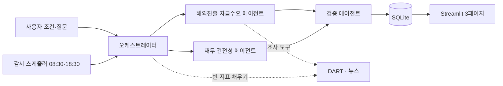

# STRIDE

**공시 근거로 "해외 진출 자금이 필요한 국내 상장사"를 발굴하는 멀티에이전트**

STRIDE는 DART 공시와 뉴스를 읽어 해외 진출 신호가 있는 기업을 찾고, 자금 압박·차입 여력·재무 위험 지표를 근거 공시와 함께 보여주는 투자처 발굴 에이전트입니다. 투자 판단을 대신하지 않고, 확인된 사실로 KIC 투자 담당자의 1차 스크리닝을 돕습니다.


> 이 저장소는 KIC AI Agent 공모전 출품작의 MVP입니다. 출력은 투자 조언이 아닙니다.

---

## 목차

1. [왜 만들었나](#왜-만들었나)
2. [무엇을 보여주나](#무엇을-보여주나)
3. [아키텍처](#아키텍처)
4. [지표 체계와 근거](#지표-체계와-근거)
5. [도구와 외부 API](#도구와-외부-api)
6. [설계 원칙](#설계-원칙)
7. [평가 결과](#평가-결과)
8. [설치와 실행](#설치와-실행)
9. [폴더 구조](#폴더-구조)
10. [한계와 로드맵](#한계와-로드맵)
11. [데이터 출처와 면책](#데이터-출처와-면책)

---

## 왜 만들었나

해외 투자 계획은 타법인 취득, 신규시설투자, 유상증자·CB 자금 용도 같은 공시에 흩어져 있습니다. 상장사 약 4,000곳의 공시를 사람이 매일 읽어 후보를 찾기는 어렵습니다.

STRIDE는 이 과정을 세 가지 질문으로 나눕니다.

| 질문 | STRIDE가 보는 것 |
|---|---|
| 해외로 나가고 있는가 | 해외 투자 확정, 해외 용도 조달, 계획 변경·철회 공시 |
| 자체 자금으로 감당되는가 | 유동성 원천과 소요 (S&P 방식을 공시 범위로 준용) |
| 더 빌리거나 투자 검토가 가능한가 | 차입 여력(한국기업평가 정의), 재무 위험(거래소 공시가이드) |

"자금이 필요하다"고 단정하지 않습니다. 지표와 근거를 나란히 보여주고 판단은 사람이 합니다.

## 무엇을 보여주나

Streamlit 화면 3페이지입니다.

| 페이지 | 내용 |
|---|---|
| 기업 발굴 | 조건을 입력하면 해외 진출 신호가 있는 기업이 보드에 뜹니다. 기본 정렬: 해외 용도 조달 진행 → 원천÷소요 낮은 순 |
| 기업 상세 | A~D 지표 카드, 근거 보고서, 에이전트 조사 과정(도구·이유·결과) |
| 관심 기업 추적 | 하루 2회 새 공시 감시, 경보(새 조달, 계획 철회, 위험 공시)와 조사 요약 |


## 아키텍처



| 구성 요소 | 역할 | LLM |
|---|---|---|
| 오케스트레이터 | 질문 의도 해석, 탐색 깔때기(상장사 → 해외 관련 공시 → 상세 분석), 감시, 빈 지표 채우기 | 사용 |
| 해외진출 자금수요 에이전트 | 공시·사업보고서·뉴스에서 해외 진출 신호 추출, 원천·소요 계산 | 분류·추출만 |
| 재무 건전성 에이전트 | 재무제표·주석·감사의견으로 지표 계산, 상장 규정 경보 | 사용 안 함 |
| 검증 에이전트 | 숫자를 원 공시로 재대조, 근거 없는 문장 제거 | 문장 대조만 |

### 자율과 규칙의 경계

| 구분 | 누가 정하나 | 내용 |
|---|---|---|
| 자율 | LLM 에이전트 | 다음에 쓸 조사 도구와 인자, 조사 중단 시점, 경보 알림 시점, 조사 요약 문장 |
| 규칙 | 코드 | 숫자 채택(채택 게이트), 프로젝트 연결과 단계, 경보 종류, 범위 판정 |
| 검증 | 검증 에이전트 | 요약·보고서 문장과 원문 대조 |

에이전트가 찾은 숫자는 코드가 같은 공시·표·행에서 다시 읽어 일치할 때만 채택합니다.

## 지표 체계와 근거

점수, 등급, 가중합은 만들지 않습니다.

| 축 | 지표 | 근거 |
|---|---|---|
| A. 해외 진출 신호 | 해외 투자 확정, 해외 용도 조달, 계획 변경·철회, 신규 계획 문단·뉴스(보조) | 법정 공시 |
| B. 유동성 원천·소요 | 원천 ÷ 소요, 원천 − 소요, 항목별 내역 | S&P *Liquidity Descriptors for Global Corporate Issuers*(2014, 2019 가이드)를 공시 범위로 준용한 STRIDE 정의 |
| C. 차입 여력 | 부채비율, 순차입금/EBITDA, EBITDA/이자비용 | 한국기업평가 「주요 재무지표의 정의」 |
| D. 재무 위험 | 자본잠식률, 감사의견, 회생 신청, 거래정지 | 한국거래소 유가증권·코스닥 공시가이드(2026.2.2) |

- 원천 = 현금및현금성자산 + 단기금융상품 + TTM 영업현금흐름 + 확정 조달(해외 용도, 발행 확정)
- 소요 = 24개월 내 해외 투자액 + 1년 내 만기 차입금(리스 제외) + 직전 사업연도 배당금
- S&P와 달리 은행 약정 한도와 회사 전망치는 넣지 않습니다(공시에 없음). 그래서 자금 부족이 실제보다 크게 보일 수 있고, 화면에 이를 표시합니다.

## 도구와 외부 API

### 1) 에이전트 조사 도구: LLM이 고르는 도구 (`stride/agents/common/tools.py`)

비어 있는 지표를 채우거나 감시 중 새 공시를 조사할 때, LLM이 다음에 쓸 도구와 인자를 고릅니다. 모든 도구는 읽기 전용이고, 기준일(as_of)을 강제 인자로 받아 그 이후 정보는 돌려주지 않습니다.

| 도구 | 호출 조건 | 입력 → 출력 | 실패 시 행동 |
|---|---|---|---|
| read_financials | 원천·소요 구성 계정(현금, 단기금융상품, 단기차입금 등)이 비었을 때 | 기업, 접수번호, 계정 키워드 → 재무제표 계정 행(값, 단위, 위치) | 오류를 조사 결과로 기록하고 루프 계속. LLM은 주석 표나 첨부로 전환 |
| read_document_section | 공시 본문·사업보고서의 특정 절(자금 사용 목적, 배당 등)이 필요할 때 | 접수번호, 절 이름 → 절 텍스트 | 같음. 다른 절이나 관련 공시로 전환 |
| find_related_filings | 새 공시를 정정·발행결과·종속회사 공시와 연결할 때 | 기업, 접수번호 → 관련 공시 목록 | 빈 목록이면 연결 없이 진행 |
| list_filings | 기간 내 공시를 훑어 근거 후보를 찾을 때 | 기업, 기간, 공시 유형 → 공시 목록 | 같음 |
| read_note_table | 상각비·리스·금융원가처럼 주석 표에만 있는 값이 필요할 때 | 접수번호, 주석 종류 → 표 | 같음. 끝까지 못 찾으면 해당 지표는 "산출 불가(사유)" |
| read_zip_attachment | 본문에 없는 연결감사보고서 첨부가 필요할 때 | 접수번호, 첨부 종류 → 텍스트 | 같음 |
| search_news | 공시만으로 맥락이 부족할 때(보조 근거) | 검색어, 기간 → 기사 목록(낮은 등급 표시) | 그 실행에서 도구 목록에서 빼고 공시 근거로만 진행 |

**루프 공통 규칙** (`stride/core/agent_loop.py`)

| 상황 | 행동 |
|---|---|
| 한 루프에서 6스텝 도달 | 강제 종료. 못 찾은 값은 "산출 불가(사유)" |
| 같은 도구를 같은 인자로 다시 호출 | 실행하지 않고 "중복 호출"로 돌려줌 |
| DART 일일 한도 초과(응답코드 020) | 오류를 삼키지 않고 올려 실행 중단. 같은 날 재시도하지 않고 대상은 "분석 대기"로 남김 |
| LLM이 숫자를 찾았다고 답함 | 채택 게이트(`gate.py`)가 같은 공시·표·행을 코드로 다시 읽어 일치할 때만 채택. 원문을 못 읽거나 값이 다르면 기각 |

**호출 실적과 정리:** 실행 기록(`orc_agent_traces`)을 집계하면 7개 도구 모두 한 번 이상 호출됐습니다.

| 도구 | 호출 수 |
|---|---|
| read_document_section | 41 |
| read_financials | 34 |
| find_related_filings | 20 |
| read_note_table, list_filings, search_news | 각 4 |
| read_zip_attachment | 2 |

채택 게이트는 43회 실행되어 채택 28, 원문에서 찾지 못함 13, 불일치로 기각 2건이었습니다. 개발 중 한 번도 호출되지 않던 `read_xbrl`은 삭제했습니다.

### 2) 파이프라인 호출: 코드 규칙이 부르는 호출 (`stride/core/clients`, `stride/core/llm.py`)

탐색 깔때기, 기업 분석, 감시는 순서가 정해져 있어 LLM이 고르지 않고 코드가 부릅니다.

| 호출 | 호출 조건 | 입력 → 출력 | 실패 시 행동 |
|---|---|---|---|
| 공시 목록 (DART list) | 탐색 1단계, 감시 08:30·18:30 | 기간, 기업 → 공시 목록 | 네트워크 오류는 3회 재시도(지수 대기). 020이면 중단·대기 |
| 공시 원문 (DART document) | 해외 신호 공시와 사업보고서를 읽을 때 | 접수번호 → 본문·첨부 | 원문 실패 시 해당 절을 비워 두고 진행. 신호 강도는 낮게 남김 |
| 주요사항 (DART DS005) | 타법인 취득, 유상증자, CB·BW 발행 공시 | 기업, 기간, 유형 → 금액·자금 용도 구조화 필드 | 결과 없음(013)은 빈 결과 |
| 재무제표·감사의견 (DART) | 재무 건전성 에이전트 계산 | 기업, 연도, 보고서 → 계정·의견 | 값이 없으면 지표를 "산출 불가(사유)"로 표시 |
| 뉴스 (네이버) | 공시 신호가 있는 기업의 보조 근거 | 검색어, 기간 → 기사 | 검색어 생성 실패 시 기본 검색어만 사용. 검색 실패 시 공시만으로 진행 |
| LLM (`claude -p`) | 공시 문단 분류, 추출, 보고서 문장 | 프롬프트 + 출력 스키마 → 검증된 JSON | 스키마 오류면 오류를 붙여 1회 재호출. 그래도 실패하면 단계별 기본 경로(보고서는 템플릿, 검증은 "미검증") 또는 "분석 대기" |

DART 응답은 로컬 캐시에 저장해 같은 요청을 다시 보내지 않습니다.

### 3) 외부 API

| API | 제공처 | 용도 | 이용 조건 | 한도·장애 대응 |
|---|---|---|---|---|
| [OpenDART](https://opendart.fss.or.kr) | 금융감독원 | 공시, 주요사항(DS005), 재무제표, 감사의견 | 무료 인증키 발급, 키당 하루 20,000회 | 응답 캐시, 020이면 그날 중단, 오류 3회 재시도 |
| 네이버 검색 API(뉴스) | 네이버 클라우드 API HUB | 뉴스 검색 | 애플리케이션 등록, 하루 25,000회, 호출당 최대 100건 | 실패 시 그 실행에서 뉴스 제외 |
| Claude (`claude -p`) | Anthropic | 분류, 추출, 조사 루프, 보고서 문장 | Claude 구독 사용량 한도 내 사용 | 한도·시간 초과 시 "분석 대기", 운영 시 API 전환 |

## 설계 원칙

1. **미래 정보 차단:** 모든 조회는 기준일 이전에 접수된 공시만 씁니다. 정정 공시도 접수일 기준으로 판단합니다.
2. **모든 숫자에 출처:** 값마다 근거 공시(접수번호)와 계산식을 붙입니다.
3. **원문 미확인 값 금지:** 출처를 확인하지 못한 임계값·구간·산식은 쓰지 않습니다. 공식 정의와 다르게 쓴 산식은 "STRIDE 정의"로 표기합니다.
4. **판단하지 않음:** 점수·등급·추천을 만들지 않습니다.
5. **missing을 숨기지 않음:** 계산할 수 없으면 "산출 불가(사유)"로 표시합니다.

## 평가 결과

2026-11-11 기준입니다.

| 항목 | 결과 |
|---|---|
| 단위·화면 테스트 | 438 passed |
| 정답지(골든) | 해외진출 8/8, 재무 건전성 14/14. 값은 DART 원문으로 대조(AI 검수) |
| 백테스트 사전 포착률 | 2/3 (평균 181일 전 포착), as_of 이후 근거 0건 |
| 데모 탐색 깔때기 | 상장사 4,011 → 해외 관련 공시 406 → 상세 분석 5(첫 실행 상한) → 보드 1 |
| 원천 ÷ 소요 산출률 | 9/14 (64%) |
| 에이전트가 잘못 채운 값 | 0건 (채택 게이트) |
| 비용(빈 지표 채우기) | 대상 기업당 평균 LLM 4.8회, 약 8.3만 토큰, 35초 |

## 설치와 실행

### 준비물

| 항목 | 내용 |
|---|---|
| Python | 3.11 이상 (개발·검증 3.13) |
| OpenDART 인증키 | [opendart.fss.or.kr](https://opendart.fss.or.kr)에서 무료 발급 |
| 네이버 검색 API 키 | 네이버 클라우드 API HUB에서 애플리케이션 등록 (없으면 뉴스 보조 근거만 빠지고 실행됨) |
| Claude Code | [설치](https://docs.claude.com/en/docs/claude-code) 후 `claude`를 한 번 실행해 로그인. STRIDE는 `claude -p`로 LLM을 호출함 |

### 설치

Windows (PowerShell)

```
git clone https://github.com/<your-id>/STRIDE.git
cd STRIDE
python -m venv .venv
.venv\Scripts\python.exe -m pip install -r requirements.txt
copy .env.example .env
```

macOS / Linux

```
git clone https://github.com/<your-id>/STRIDE.git
cd STRIDE
python3 -m venv .venv
.venv/bin/python -m pip install -r requirements.txt
cp .env.example .env
```

`.env`를 열어 키를 넣습니다. 나머지 값은 기본값 그대로 두면 됩니다.

| 변수 | 설명 |
|---|---|
| DART_API_KEY | OpenDART 인증키 (필수) |
| NAVER_CLIENT_ID, NAVER_CLIENT_SECRET | 네이버 검색 API 키 |
| NAVER_NEWS_PROVIDER, NAVER_NEWS_URL | 뉴스 API 경로 (기본값 유지) |
| STRIDE_DB_PATH, STRIDE_LOG_DIR | DB·로그 위치 (기본 `./data`) |

연결 확인

```
python scripts/check_claude_cli.py
python scripts/check_naver_news.py
```

### 실행

모든 명령은 저장소 최상위 폴더에서 실행합니다. 아래 `python`은 가상환경의 파이썬입니다(Windows `.venv\Scripts\python.exe`, macOS/Linux `.venv/bin/python`).

화면으로 쓰기: 터미널 두 개에서 각각 실행합니다. worker는 화면에서 요청한 탐색·검토·질문을 처리합니다.

```
python -m stride.cli orchestrator worker
```

```
python -m streamlit run stride/ui/app.py
```

브라우저에서 `http://localhost:8501`이 열립니다. 처음에는 DB가 비어 있으니 "기업 발굴"에서 조건을 넣고 탐색을 실행하세요. 첫 실행은 상세 분석 대상을 5곳으로 제한합니다.

명령줄로 쓰기

```
python -m stride.cli orchestrator discover --as-of 2026-11-05
python -m stride.cli orchestrator review --company <종목코드> --as-of 2026-11-05
python -m stride.cli orchestrator monitor
python -m stride.cli show --run-id <run_id>
```

데모 한 번에 돌리기 (탐색 → 첫 기업 검토 → 질문 1건 → 감시 1회)

```
python scripts/run_orchestrator_demo.py 2026-11-05
```

DART 응답은 `data/cache`에 저장되어 같은 요청은 다시 보내지 않습니다. 결과 DB는 `data/stride.db`, LLM 호출 기록은 `data/logs/llm`에 남습니다.

### 테스트

```
cd stride
python -m pytest
python -m pytest -m golden
python -m pytest -m llm
```

| 묶음 | 내용 | 필요한 것 |
|---|---|---|
| 기본 | 단위·화면 테스트 438개 | 없음 (외부 호출 없음) |
| `-m golden` | 정답지와 실제 공시 대조 | DART_API_KEY |
| `-m llm` | 실제 Claude 호출 | Claude Code 로그인 |

평가 스크립트: `scripts/replay.py`(백테스트), `scripts/eval_fill.py`(빈 지표 채우기), `scripts/monitor_replay.py`(감시 재생), `scripts/run_batch_month.py`(과거 1개월 배치).

## 폴더 구조

```
stride/
  agents/
    overseas_funding/   해외진출 자금수요 에이전트 (노드, 프롬프트, 계산)
    financial_health/   재무 건전성 에이전트
    verifier/           검증 에이전트
    common/             조사 도구, 채택 게이트
  orchestrator/         탐색·검토·답변·감시 그래프, 빈 지표 채우기, 조사
  core/                 DART·뉴스 클라이언트, 기준일 처리, 근거, 계산 함수, LLM 호출
  ui/                   Streamlit 3페이지
  tests/                unit, golden(정답지), replay, ui
scripts/                연결 확인, 데모, 백테스트·평가
docs/
  agents/               에이전트별 개발문서
  criteria/             지표 목록(metrics_catalog.yaml), claude -p 호출 규칙
  STRIDE_MVP_구성문서.md 전체 설계
requirements.txt
.env.example
```

## 한계와 로드맵

| 한계 | 계획 |
|---|---|
| 원천÷소요 산출률 64% (배당금 탐색 실패, 기타금융자산 안 예금, 비원화) | 배당금 규칙 우선 적용, 주석에 예금이 명시된 경우 반영 |
| 백테스트 사례 3건 | 10건 이상으로 확대, 정밀도(보드 기업의 실제 조달 비율) 측정 |
| 정답지는 AI 원문 대조, 사람 확인 0건 | 핵심 정답지 사람 검수 |
| 감시 조사 요약 일부 문장이 검증에서 제거됨 | 원문 본문 숫자까지 대조하도록 검증 확장 |
| 결산월 12월 가정 | 기업개황 결산월 사용 |
| 시가총액 없음(시세 API 미연결), 뉴스 파일 소스 미구현 | 공공데이터포털 시세 연결 |
| Claude 구독 사용량 한도 | 운영 시 Claude API 전환 |

## 데이터 출처와 면책

- 공시 데이터: 금융감독원 전자공시시스템(DART), OpenDART API
- 뉴스: 네이버 검색 API
- 지표 정의: S&P Global Ratings, 한국기업평가, 한국거래소 공시가이드
- DART 원문 캐시와 실행 DB(`data/`)는 저장소에 포함하지 않습니다.
- STRIDE의 출력은 공시 사실의 정리이며 투자 권유나 투자 조언이 아닙니다.

## 라이선스

(라이선스를 정해 기재)
