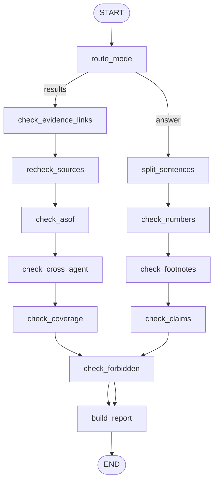

# 검증 에이전트 — 개발문서

> 문서 버전: v0.1 (2026-11-04) — 최초 작성. MVP 구성문서 v1.4 4.5장 기준
> 대상 독자: 이 문서만 보고 코드를 작성할 개발자 또는 코딩 AI
> 관련 문서: `STRIDE_MVP_구성문서_v1.5.md`, `오케스트레이터_개발문서.md`(v0.5), `공통기준/metrics_catalog.yaml`(v0.10)
> agent_key: `verifier` · 약어: `ver`
> 따르는 공통 양식: `공통기준/skills/stride-agent-dev-standard`

---

## 0. 이 문서를 읽는 AI에게

1. **노드·스키마·함수 이름을 바꾸지 않는다.** 오케스트레이터가 이 이름으로 호출한다.
2. **새 데이터를 수집하지 않는다.** 허용되는 외부 호출은 이미 근거로 쓰인 원문(evidence_id가 가리키는 DART 응답·문서)의 **재조회**뿐이다. 새 기사 검색, 새 공시 검색은 금지한다.
3. **판단하지 않는다.** 등급·신뢰도 점수·실사 우선순위를 만들지 않는다. 출력은 "통과 / 불일치 / 확인 불가" 사실 목록뿐이다. 실사 확인 목록은 오케스트레이터가 만든다.
4. **계산 대조는 코드로 한다.** LLM은 answer 모드의 "문장이 근거 인용문과 같은 사실을 말하는가" 한 가지에만 쓴다.
5. **`※확인` 항목은 추측하지 말고 TODO로 남긴다.**
6. 특정 기업명·종목코드를 코드·설정·예시에 넣지 않는다.

---

## 1. 목적과 범위

### 1.1 목적

전문 에이전트 결과(`AgentResult`)와 오케스트레이터가 만든 최종 문서(발굴 보드 요약, 사전검토서, 질의 답변)가 **근거와 일치하는지 코드로 대조**하고, 불일치·확인 불가 항목을 `VerificationReport`로 돌려준다.

### 1.2 실행 모드

| 모드 | 호출 위치 | 입력 | 출력 |
|---|---|---|---|
| `results` | discover·review·monitor 그래프의 `verifier(results)` | 기업 1곳의 `AgentResult` 목록 (ovs, fin) + as_of + 필수 지표 목록 | `VerificationReport` |
| `answer` | `verifier(answer)` | 오케스트레이터가 쓴 문서 텍스트(Markdown) + 그 문서가 인용한 AgentResult·BoardRow | `VerificationReport` |

### 1.3 범위 밖

- 부정 신호·보도 괴리 수집 (해외진출 에이전트 `merge_signals` 담당)
- 결격·주의 규칙 적용 (오케스트레이터 `apply_rules`)
- 실사 확인 목록 작성, 신뢰도 등급 (오케스트레이터)
- 검증 실패 시 재작성 (오케스트레이터가 1회 재작성)

---

## 2. 데이터 출처와 접근성

| 데이터 | 출처 | 접근 방법 | 시점 필터 | 접근 확인 상태 |
|---|---|---|---|---|
| AgentResult | 오케스트레이터 상태 / SQLite `runs` | 내부 | — | 확인됨 (내부) |
| 근거 원문 재조회 (DART 구조화·재무·문서) | OpenDART (`core/clients/dart.py`, 캐시 우선) | API 키 | 근거 `published_at` ≤ as_of 검사 | ※확인 (해외진출 에이전트 1단계와 같음) |
| 근거 원문 재조회 (뉴스) | 캐시된 기사 description (`data/cache/news/`) | 내부 캐시만. 재검색 금지 | 같음 | 확인됨 (내부) |
| 시장 데이터 재조회 | KRX / 공공데이터포털 캐시 | 캐시 우선 | 같음 | ※확인 |

재조회는 `core/clients/*`의 캐시를 먼저 쓴다. 캐시에 없을 때만 API를 다시 부르고, 그래도 실패하면 "확인 불가"로 남긴다.

---

## 3. 출력 정의

검증 에이전트는 지표를 만들지 않는다. `metrics_catalog.yaml`에 등록하는 항목이 없다. 출력은 4장의 `VerificationReport` 하나다.

### 3.1 results 모드 점검 항목

| 코드 | 점검 | 방법 | 실패 시 기록 |
|---|---|---|---|
| R-01 | 모든 Metric·Classification·Finding에 evidence_id가 있고 `result.evidence`에 존재 | 코드 | `missing_evidence` |
| R-02 | 근거 원문 값과 일치 | DART 구조화·재무 근거: 재조회한 응답의 해당 필드 값과 Metric 입력값 비교(허용오차 config `VALUE_TOLERANCE`). CALC 근거: meta의 입력과 수식으로 재계산 | `value_mismatch` / `unverifiable` |
| R-03 | 근거 날짜 ≤ as_of | 코드 | `future_evidence` |
| R-04 | 교차 일치: 같은 metric_id(특히 `fin.cash_and_equivalents`, `fin.short_term_financial_assets`, `fin.ttm_operating_cash_flow`)를 ovs `metrics`(해외진출 3.6에서 이 세 지표를 Metric으로 출력)와 fin `metrics`가 모두 냈다면 값이 같은가 | 코드 | `cross_agent_mismatch` |
| R-05 | 필수 지표 커버리지: 호출자가 준 필수 지표 목록(오케스트레이터 config `REQUIRED_METRICS`)이 모두 있고 data_status가 무엇인가 | 코드 | `coverage_gap` (missing·needs_due_diligence 구분) |
| R-06 | 금지 필드·평가어 없음 | `core/report_guard.py` (필드명 + `report_markdown` 문자열) | `forbidden_term` |
| R-07 | 카탈로그 등록 여부 | `core/catalog.validate` | `unregistered_metric` |

### 3.2 answer 모드 점검 항목

| 코드 | 점검 | 방법 | 실패 시 기록 |
|---|---|---|---|
| A-01 | 문서의 모든 숫자가 인용한 AgentResult·BoardRow 값과 일치 | 코드: 숫자 토큰 추출(`core/units.py`로 억 원·%·배 정규화) → 같은 문장의 각주 evidence_id에 연결된 Metric 값과 비교. 반올림 표시 허용 | `number_mismatch` / `number_without_source` |
| A-02 | 각주 evidence_id가 실존 | 코드 | `broken_footnote` |
| A-03 | 문장의 사실 주장이 근거와 같은 사실 | LLM (`check_claim.md`): 문장 1개 + 근거 인용문(quote) → supported / not_supported / insufficient | `claim_not_supported` / `claim_insufficient` |
| A-04 | 출처 없는 판단 표현 없음 | 코드: `FORBIDDEN_TERMS`. 단 오케스트레이터 규칙 결과 문구(`RULE_PHRASES`, 예: "관리종목 지정 사유 해당")는 허용 | `judgment_without_source` |

A-03은 비용을 줄이기 위해 **A-01·A-02를 통과한 문장 중 숫자·고유명사를 포함한 문장만** LLM에 보낸다. 문서당 최대 `MAX_CLAIM_CHECKS`(기본 12, 보정 전: 처리량 측정 후 조정)건.

---

## 4. 데이터 모델 (`agents/verifier/schemas.py`)

```python
from typing import Literal
from pydantic import BaseModel, Field

class CheckItem(BaseModel):
    code: str                                  # R-01 ... A-04
    outcome: Literal["pass", "fail", "unverifiable"]
    kind: str | None = None                    # missing_evidence, value_mismatch, ...
    target: str                                # metric_id, finding_id, 문장 번호 등
    expected: str | None = None                # 근거 쪽 값
    actual: str | None = None                  # 검사 대상 쪽 값
    note: str | None = None
    evidence_ids: list[str] = []               # 대조에 쓴 근거 (pass·fail 모두)

class VerificationReport(BaseModel):
    """판단 없는 대조 결과. 점수·등급 필드를 두지 않는다."""
    request_id: str
    mode: Literal["results", "answer"]
    as_of: str
    corp_code: str | None
    checks: list[CheckItem]
    failed: list[CheckItem]                    # outcome == fail
    unverifiable: list[CheckItem]
    coverage: dict[str, str] = {}              # metric_id → ok / missing / needs_due_diligence / absent
    failed_targets: list[str] = []             # 결론에 쓰면 안 되는 metric_id·문장 번호 (오케스트레이터 R5 입력)
    llm_calls: int = 0

class ClaimCheckOutput(BaseModel):             # prompts/check_claim.md 출력
    verdict: Literal["supported", "not_supported", "insufficient"]
    reason: str = Field(max_length=200)
```

---

## 5. 그래프 상태

```python
class VerifierState(TypedDict, total=False):
    request: dict                    # {request_id, mode, as_of, corp_code, required_metrics}
    results: list[AgentResult]       # results 모드
    document: str | None             # answer 모드
    cited: dict                      # answer 모드: {evidence_id: Metric·BoardRow 값}
    sentences: list[dict]            # answer 모드: [{no, text, footnotes, numbers}]
    checks: Annotated[list[CheckItem], operator.add]
    llm_calls: int
    report: VerificationReport | None
    errors: Annotated[list[str], operator.add]
```

---

## 6. 그래프 구조



| # | 노드 | 종류 | LLM | 다음 |
|---|---|---|---|---|
| 1 | `route_mode` | 라우팅 | X | 모드별 |
| 2 | `check_evidence_links` | 코드 (R-01, R-07) | X | `recheck_sources` |
| 3 | `recheck_sources` | 코드 + 캐시 재조회 (R-02) | X | `check_asof` |
| 4 | `check_asof` | 코드 (R-03) | X | `check_cross_agent` |
| 5 | `check_cross_agent` | 코드 (R-04) | X | `check_coverage` |
| 6 | `check_coverage` | 코드 (R-05) | X | `check_forbidden` |
| 7 | `split_sentences` | 코드 | X | `check_numbers` |
| 8 | `check_numbers` | 코드 (A-01) | X | `check_footnotes` |
| 9 | `check_footnotes` | 코드 (A-02) | X | `check_claims` |
| 10 | `check_claims` | LLM (A-03) | O | `check_forbidden` |
| 11 | `check_forbidden` | 코드 (R-06 / A-04) | X | `build_report` |
| 12 | `build_report` | 코드 | X | END |

재시도 루프 없음. 재작성은 오케스트레이터가 한다.

---

## 7. 시점 통제

| 경로 | 규칙 | 구현 위치 |
|---|---|---|
| 근거 날짜 | 모든 evidence의 `published_at` ≤ request.as_of | `check_asof` |
| 재조회 | 재조회 응답도 원래 `rcept_no`로만 조회. 최신 정정본으로 바꿔 조회하지 않는다 | `recheck_sources` |
| LLM | `check_claim.md`에는 문장과 근거 인용문만 넣는다. "자료에 없는 사실은 insufficient" 규칙을 프롬프트와 출력 모델에 둔다 | `check_claims` |

---

## 8. 노드 명세 (요약)

```python
def recheck_sources(state) -> dict:
    """R-02. 근거 종류별 재조회 대조.
    처리:
        1. FIN 근거: (rcept_no, fs_div, account_id)로 캐시된 fnlttSinglAcntAll 응답에서 금액을 다시 읽어 Metric 입력과 비교.
        2. DART 구조화 근거: (rcept_no, api, field)로 캐시 응답 필드 비교.
        3. CALC 근거: meta.inputs(evidence_id 목록)와 meta.formula로 재계산 (core.calc의 같은 함수 호출).
        4. NEWS 근거: 캐시 description에 quote가 포함되는지만 확인 (재검색 금지).
        5. 캐시·재조회 모두 실패 → unverifiable.
    LLM: 없음.
    """

def check_cross_agent(state) -> dict:
    """R-04. 같은 metric_id를 두 에이전트가 낸 경우 값이 같은지 비교.
    ovs는 재무 기본 항목 3개를 metrics에 Metric으로 출력한다(해외진출 개발문서 3.6). fin.metrics와 metric_id로 맞춘다.
    허용오차 0원(같은 core.calc 함수를 쓰므로). 다르면 fail, 두 값과 근거를 모두 기록.
    """

def check_numbers(state) -> dict:
    """A-01. 문장마다 숫자 토큰을 core.units.parse로 정규화하고, 같은 문장 각주의 evidence_id에 연결된 값과 비교.
    표시 반올림 허용: 억 원은 ±0.5억, %는 ±0.05%p, 배는 ±0.05배 (config DISPLAY_TOLERANCE).
    각주가 없는데 숫자가 있으면 number_without_source.
    """

def check_claims(state) -> dict:
    """A-03. 숫자·고유명사를 포함한 문장만 prompts/check_claim.md로 확인. 최대 MAX_CLAIM_CHECKS건.
    초과분은 unverifiable(kind="claim_check_skipped")로 남긴다.
    """

def build_report(state) -> dict:
    """checks를 모아 VerificationReport를 만든다. failed_targets = fail 항목의 target 목록.
    점수·등급을 만들지 않는다."""
```

---

## 9. 외부 연동

해외진출 에이전트 개발문서 8.1, 재무 건전성 에이전트 개발문서 9장의 공통 클라이언트를 그대로 쓴다. 이 에이전트는 **캐시 읽기 함수**(`core.clients.dart.get_cached(rcept_no, api)`)를 주로 쓴다. 캐시 키 형식은 공통 클라이언트 구현 시 확정 ※확인.

---

## 10. 저장소

```sql
CREATE TABLE verifier_reports (
  request_id TEXT, run_id TEXT, mode TEXT, as_of TEXT, corp_code TEXT,
  n_checks INTEGER, n_failed INTEGER, n_unverifiable INTEGER,
  report_json TEXT, created_at TEXT,
  PRIMARY KEY (request_id, mode, run_id)
);
```

---

## 11. 프롬프트

### 11.1 `check_claim.md`

```markdown
## 작업
아래 문장이 근거 인용문과 같은 사실을 말하는지 확인하세요. 문장이 맞는지 틀린지 세상 지식으로 판단하지 마세요.
근거 인용문에 없는 내용이 문장에 있으면 insufficient 입니다.

## 판단 기준
- supported: 문장의 사실(주체, 대상, 수치, 날짜, 행위)이 모두 인용문에 있다
- not_supported: 인용문과 다른 사실을 말한다
- insufficient: 인용문만으로는 확인할 수 없다

## 자료
<자료>
문장: {sentence}
근거: {quotes}
</자료>

## 출력 형식 (JSON)
{"verdict": "supported" | "not_supported" | "insufficient", "reason": "200자 이내"}
```

출력 모델: `ClaimCheckOutput`.

---

## 12. 계산 규칙

계산을 새로 하지 않는다. R-02의 CALC 재계산은 해당 metric의 `implementation` 함수를 그대로 호출한다(`core/catalog.py`의 `get_impl(metric_id)`).

---

## 13. 테스트

| 종류 | 케이스 |
|---|---|
| 단위 R-01 | evidence_ids가 evidence 목록에 없는 Metric → fail |
| 단위 R-02 | FIN 값 1원 다름 → fail / CALC 수식 재계산 불일치 → fail / 캐시 없음 + API 실패 → unverifiable |
| 단위 R-03 | as_of 다음 날 근거 → fail |
| 단위 R-04 | ovs와 fin의 현금 값 다름 → fail |
| 단위 R-06 | report_markdown에 "유망" → fail |
| 단위 A-01 | "1,410억 원"과 Metric 141,012,345,678원 → pass(반올림) / 1,510억 → fail / 각주 없는 숫자 → fail |
| 단위 A-04 | "관리종목 지정 사유 해당"(규칙 문구) → pass / "투자 적합" → fail |
| 골든 V-CLEAN | 정상 결과 2개(ovs, fin) → failed 0건 |
| 골든 V-TAMPER | 같은 결과에서 숫자 1개, 날짜 1개, 각주 1개를 고의로 바꾼 사본 → 정확히 3건 fail |
| 평가 | 고의 변조 탐지 재현율 100%, 정상 문서 오탐 0건 (골든 기준) |

---

## 14. 구현 순서와 완료 기준

| 단계 | 작업 | 완료 기준 |
|---|---|---|
| 1 | 공통 클라이언트 캐시 키 확인 | 해외진출·재무 에이전트 1단계 결과로 캐시 조회 함수 확정 (※확인 해소) |
| 2 | results 모드 R-01~R-07 | 단위 테스트 통과 |
| 3 | answer 모드 A-01, A-02, A-04 (LLM 없음) | 단위 테스트 통과 |
| 4 | A-03 LLM | V-CLEAN·V-TAMPER 골든 통과, 문서 1건당 LLM 호출 수 기록 |
| 5 | 오케스트레이터 연동 | review_graph에서 실패 → 1회 재작성 → '검증 실패' 표시 흐름 통과 |

## 부록. 용어

| 용어 | 뜻 |
|---|---|
| 재조회 | 이미 근거로 쓰인 원문을 같은 ID로 다시 읽는 것. 새 검색이 아님 |
| 확인 불가 | 재조회·대조를 할 수 없어 통과도 실패도 아닌 상태 |
