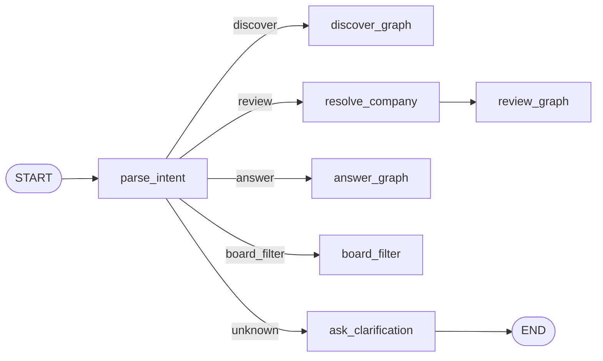
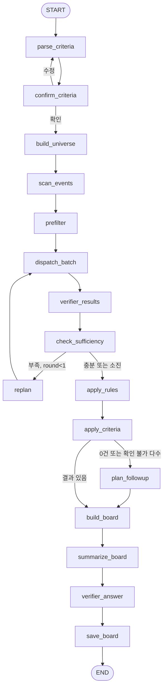
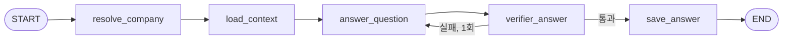

# 오케스트레이터 — 개발문서

> 문서 버전: v0.9 (2026-11-11) — 7.6a 도구 표(호출 조건·입출력·실패 시 행동), 외부 API 표, read_xbrl 제거, 반복 호출 차단, DART 020·뉴스 실패 처리
> (v0.8 (2026-11-11) — 자율성 추가: D1 = 조사 루프로 빈 지표 찾기(`fill.py`, 채택 게이트), 감시 새 공시 조사(`investigate.py`), 조사 기록 `orc_agent_traces`·`orc_investigations`, 자율/규칙 경계 표(7.6a)
> (v0.7 (2026-11-10) — 방향 수정: 기본 탐색 = G1~G4 + S4·S5(자금 공백·상장 규정으로 거르지 않음, 값 없음은 제외하지 않음), BoardRow `liquidity`·`funding_status`·`risk_warnings`, 기본 정렬, board_filter 필드 추가, REQUIRED_METRICS의 자금 공백 비율 → 원천÷소요
> (v0.6 (2026-11-05) — `first_run_max_deep_analysis` 추가(첫 실제 실행 5곳 제한, 4장 prefilter), BoardRow `funding_gap.unconfirmed_funding`
> (v0.5 (2026-11-05) — `REQUIRED_METRICS`의 재무 지표를 `fin.debt_ratio`·`fin.ttm_operating_cash_flow`로 교체, 순차입금·EBITDA 계열은 `OPTIONAL_METRICS`로 이동(7.2)
> (v0.4 (2026-11-05) — BoardRow 재무 핵심 필드를 `debt_ratio`·`ttm_operating_cash_flow`로 교체(4.2)
> (v0.3 (2026-11-04) — 1단계 API 확인 반영: 감사의견이 응답 문자열 그대로 들어오므로 규칙 입력은 AUDIT_OPINION_MAP 정규화(미매핑·범위제한 unknown → 확인 불가, 5장), data_status unknown(정정 전 원본 값 확인 불가)은 replan 대상 아님(7.2), 결정 기록 외 공통 테이블 정의는 공통 양식 10장
> (v0.2 (2026-11-04) — 확인되지 않은 정보 제거: 결격 규칙을 유가증권·코스닥 원문 확인 기준으로 시장별 분리, R4(국민성장펀드 가이드북, 원문 미확인) 삭제, 구간 표시 삭제
> (v0.1 (2026-11-04) — 최초 작성. MVP 구성문서 v1.4 2·4·5·7장, 화면 와이어프레임 v1.6 기준
> 대상 독자: 이 문서만 보고 코드를 작성할 개발자 또는 코딩 AI
> 관련 문서: `STRIDE_MVP_구성문서_v1.5.md`, `화면_데이터_연결명세.md`(v0.6), 해외진출(v0.7)·재무 건전성(v0.8)·검증(v0.1) 개발문서, `공통기준/metrics_catalog.yaml`(v0.10)
> 코드 위치: `stride/orchestrator/` · 약어: `orc`
> 따르는 공통 양식: `공통기준/skills/stride-agent-dev-standard`

---

## 0. 이 문서를 읽는 AI에게

1. **노드·스키마·테이블·함수 이름을 바꾸지 않는다.** 화면(`ui/`)과 전문 에이전트가 이 이름으로 읽는다.
2. **판단은 이 모듈에서만 한다. 단, 출처 있는 규칙으로만 한다.** 결격·주의 규칙(5장)은 출처 문서명·기준일과 함께 설정 파일에 둔다. 출처 없는 점수·등급·순위·"추천"을 만들지 않는다.
3. **정렬은 사용자가 고른 기준 또는 출처 있는 수치로만 한다.** 기본 정렬은 최근 신호일이다. 시스템이 만든 점수로 정렬하지 않는다.
4. **LLM이 그래프 경로를 자유롭게 고르게 하지 않는다.** 뼈대는 고정하고, 판단 지점(D1, D4)에서만 허용 선택지 중 하나를 고르게 한다. 결정은 모두 `decisions` 테이블에 남긴다.
5. **수치를 다시 계산하지 않는다.** 화면·문서의 숫자는 전문 에이전트 `AgentResult`에서 가져온다. 규칙 비교(예: 자본잠식률 ≥ 50)만 코드로 한다.
6. **`※확인` 항목은 추측하지 않는다.** TODO로 남긴다.
7. **특정 기업명·종목코드를 코드·프롬프트·설정·예시에 넣지 않는다.**
8. **`core/`를 바꾸는 항목(4.1의 `RouteDecision`, 9장의 `decisions` 테이블)은 공통 양식 2장 규칙대로 사용자에게 알리고 다른 에이전트 테스트를 다시 돌린다.**

---

## 1. 목적과 범위

### 1.1 목적

사용자의 자연어 입력과 저장된 탐색 조건을 받아 전문 에이전트(해외진출 자금수요, 재무 건전성)를 실행하고, 검증 에이전트로 대조한 뒤, **출처 있는 규칙만 적용해** 발굴 보드·기업 상세(사전검토서)·질의 답변·변경 알림을 만든다.

### 1.2 진입 그래프와 화면

| 그래프 | 트리거 | 산출물 | 화면 (와이어프레임 v1.6) |
|---|---|---|---|
| `route_intent` | 상단 질의창 입력 | 의도 분류 → 아래 그래프 중 하나 호출 | 모든 페이지 상단 |
| `discover_graph` | 기업 발굴 페이지 [조건 해석]·[다시 탐색], 질의창 '새 탐색' | `DiscoveryBoard` | 1. 기업 발굴 |
| `review_graph` | 기업 행 클릭, 질의창 '기업 검토' | `FinalReport` (사전검토서) | 3. 기업 상세 |
| `answer_graph` | 질의창 '결과 질문' | `Answer` (근거 각주 포함 답변) | 질의창 아래 답변 카드 |
| `board_filter` | 질의창 '보드 필터' | 현재 보드의 표시 필터 (재실행 없음) | 1. 기업 발굴 표 |
| `monitor_graph` | Windows 작업 스케줄러 1일 2회 | 알림·보드 갱신 | 2. 관심 기업 추적 |

### 1.3 범위 밖

- 지표 계산, 신호 추출 (전문 에이전트)
- 근거 대조 (검증 에이전트)
- KIC 내부 기준(목표 수익률, 투자 한도, 최소 투자 규모): 공개 데이터 없음 → Phase 2에서 사용자 설정값으로
- 접촉 우선순위·추천 등급: 출처 기준 없음 → 만들지 않음
- 로그인·권한·배포

---

## 2. 데이터 출처와 접근성

| 데이터 | 출처 | 접근 | 시점 기준 | 상태 |
|---|---|---|---|---|
| 전문 에이전트 결과 | `AgentResult` (ovs, fin), SQLite `runs` | 내부 | as_of | 확인됨 (내부) |
| 상장사 목록·업종 | OpenDART `corpCode.xml`, `company.json` | API 키 | 현재값 | ※확인 |
| 공시 목록 | OpenDART `list.json` | API 키 | `rcept_dt` ≤ as_of | ※확인 |
| 결격·주의 규칙 출처 | KIND 유가증권시장·코스닥시장 공시가이드(2026.2.2) | 공개 PDF | 문서 게시일 | 확인됨 (2026-11-04 원문 확인) |

---

## 3. 출력 정의

오케스트레이터는 `Metric`을 새로 만들지 않는다. 출력은 4장의 문서 모델(`DiscoveryBoard`, `FinalReport`, `Answer`, `RuleResult`, `FeedItem`)이다. 보드·문서의 모든 수치 칸은 출처 `metric_id`와 `evidence_ids`를 그대로 들고 간다.

### 3.1 진행 단계 표시 이름

화면·문서의 단계 표시는 카탈로그 `ovs.project_stage` 값과 1:1로 대응한다. 표시 이름은 `orchestrator/config.py`의 `STAGE_LABELS`에 둔다.

| 값 | 카탈로그 값 | 화면 표시 |
|---|---|---|
| 1 | 1 검토·언급 | 검토·언급 |
| 2 | 2 계획 공표 | 계획 발표 |
| 3 | 3 MOU·협약 | MOU·협약 |
| 4 | 4 이사회 결의 | 이사회 결의 |
| 5 | 5 집행 | 착공·인수 완료 |

---

## 4. 데이터 모델 (`orchestrator/schemas.py`)

### 4.1 공통 추가 (`core/schemas.py`에 추가 — 0장 8번)

```python
class RouteDecision(BaseModel):
    """LLM 판단 지점의 결정 1건. 해외진출 에이전트 D2·D3도 같은 모델을 쓴다."""
    point: str                               # "D1" | "D2" | "D3" | "D4"
    action: str                              # 허용 선택지 중 하나 (지점별 Literal은 각 모듈에서 검증)
    reason: str = Field(max_length=300)
    evidence_ids: list[str] = []
    accepted: bool = True                    # 검증기가 거부하면 False
    fallback_action: str | None = None       # 거부 시 실제로 실행한 기본 경로
```

### 4.2 오케스트레이터 모델

```python
class IntentResult(BaseModel):               # prompts/parse_intent.md 출력
    intent: Literal["discover", "review", "answer", "board_filter", "unknown"]
    company_mention: str | None = None       # review·answer일 때 기업 표현 원문
    filter_text: str | None = None           # board_filter일 때
    clarify_question: str | None = None      # unknown일 때 사용자에게 되물을 문장

class DiscoveryCriteria(BaseModel):
    markets: list[Literal["KOSPI", "KOSDAQ"]] = ["KOSPI", "KOSDAQ"]
    industries: list[str] = []               # 표준산업분류 코드 접두어 (예: "C" 제조업 전체, "C29" 등)
    target_regions: list[str] = []           # config REGION_MAP의 키 (예: "US", "EU", "SEA")
    investment_types: list[Literal["신설", "증설", "지분 인수"]] = []
    stages: list[int] = []                   # 1~5
    min_investment_amount: int | None = None # 원
    min_funding_gap_ratio: float | None = None
    market_cap_range: tuple[int | None, int | None] | None = None
    exclude_rule_ids: list[str] = []         # 기본: 빈 목록(표시만). 기본 탐색은 5장의 R1~R3 계열 전부
    signal_types: list[str] = []             # 예: ["S6_alert"] (연기·철회 기업 탐색)
    lookback_months: int = 12
    as_of: date
    max_deep_analysis: int = 20              # K. 2026-11-05 결정: 20 유지. 첫 실제 실행은 settings.first_run_max_deep_analysis(5)로 제한
    unparsed: list[str] = []                 # 해석 못 한 표현 (조건에 넣지 않음)

class BoardRow(BaseModel):
    corp_code: str
    corp_name: str
    market: str
    industry: str
    project: dict                            # {country, method, stage, stage_label, latest_signal_date}
    investment_amount: dict                  # {value, source: major_event|periodic|news|missing, evidence_ids}
    funding_gap: dict                        # {value, ratio, unconfirmed_funding, data_status, evidence_ids}. value는 확정 조달 기준
    debt_ratio: dict                         # fin.debt_ratio 최신 정기보고서 기준 {value, period, data_status, note, evidence_ids}
    ttm_operating_cash_flow: dict            # fin.ttm_operating_cash_flow {value, period, data_status, note, evidence_ids}
    rule_hits: list[str]                     # 해당한 RuleResult.rule_id
    change_badges: list[str]                 # new_match, amount_changed, stage_up, stage_down, plan_changed, cancelled
    verification: Literal["verified", "needs_check", "partial"]
    matched_search_ids: list[str]            # 이 기업이 걸린 다른 저장 조건
    is_watched: bool
    liquidity: dict = {}                     # v0.7 B 유동성 원천·소요: {ratio, surplus, sources, uses, cash, short_term, ttm_ocf, confirmed_funding, investment_24m, investment_beyond_24m, maturing_debt, dividends} 각 mdict
    funding_status: dict = {}                # v0.7 해외 용도 조달 상태 {label: 결과 공시 전|납입 확정|결과 공시 전·납입 확정|없음, unconfirmed, confirmed, rcept_nos}
    risk_warnings: list[str] = []            # v0.7 D 재무 위험 경고: 상장 규정 기준 해당 규칙 + 거래 상태 경고

class DiscoveryBoard(BaseModel):
    search_id: str
    run_id: str
    as_of: date
    criteria: DiscoveryCriteria
    funnel: list[dict]                       # [{"step": "universe"|"events"|"prefilter"|"deep"|"final", "count": int}]
    summary_md: str                          # summarize_board 결과 (각주 포함, 검증 통과분)
    rows: list[BoardRow]                     # 최종 조건 충족
    pending: list[dict]                      # 분석 대기 [{corp_code, corp_name, latest_filing_date}]
    excluded: list[dict]                     # [{corp_code, corp_name, step, condition, value, evidence_ids}]
    suggestions: list[RouteDecision] = []    # D4 제안 (실행 안 함)

class RuleResult(BaseModel):
    rule_id: str                             # 5장 표의 rule_id (시장별)
    hit: bool | None                         # None = 입력 데이터 없음 (needs_due_diligence)
    label: str                               # 규칙 파일의 표시 문구 (예: "관리종목 지정 사유 해당")
    source: str                              # 문서명
    source_date: str                         # 규칙 기준일
    market: str                              # KOSPI | KOSDAQ
    inputs: dict                             # {"fin.capital_impairment_ratio": 52.1, ...}
    evidence_ids: list[str] = Field(min_length=1)

class FinalReport(BaseModel):
    """사전검토서. 7.2 구조. 모든 문장에 각주."""
    report_id: str
    corp_code: str
    as_of: date
    is_partial: bool
    sections: dict[str, str]                 # summary, project, funding_gap, financial, rules, verification, opinion, appendix
    rule_results: list[RuleResult]
    due_diligence: list[str]                 # 실사 확인 목록
    verification_status: Literal["passed", "partially_failed"]
    evidence: list[Evidence]

class Answer(BaseModel):
    question: str
    answer_md: str                           # 각주 포함
    evidence_ids: list[str]
    links: list[dict]                        # [{"label": "한빛소재 상세 보기", "page": "company", "corp_code": ...}]
    verification_status: Literal["passed", "partially_failed", "no_data"]

class FeedItem(BaseModel):                   # 관심 기업 추적 화면 항목
    item_id: str
    kind: Literal["new_match", "left_match", "watch_change"]
    search_id: str | None
    corp_code: str
    alert_type: str                          # 에이전트 Alert.alert_type 또는 new_match/left_match
    before: str | None
    after: str | None
    reason: str                              # 사실 문장 (예: "유상증자로 확정 조달액 반영")
    event_date: date
    evidence_ids: list[str] = Field(min_length=1)
    read: bool = False
```

---

## 5. 결격·주의 규칙 (`orchestrator/rules.yaml`, `apply_rules`)

규칙 결과는 "탈락"이 아니라 **"어떤 공식 기준에 해당하는가"라는 사실**이다. 실행을 멈추지 않는다. **원문으로 확인한 규칙만 둔다.** 기업의 시장 구분(`company.market`)에 맞는 규칙만 적용한다.

출처: 한국거래소 KIND 「유가증권시장 공시가이드」(kospi_1.pdf), 「코스닥시장 공시가이드」(kosdaq_2.pdf), 둘 다 2026.2.2 게시, 2026-11-04 원문 확인.

| rule_id | 시장 | 입력 | 조건 | 표시 문구 |
|---|---|---|---|---|
| R1-KS | 유가증권 | `fin.audit_opinion` | 최근 사업연도 부적정 또는 의견거절 | 상장폐지 사유 해당 |
| R1b-KS | 유가증권 | `fin.audit_opinion`, `fin.audit_scope_limitation` | 감사범위 제한에 따른 한정 | 관리종목 지정 사유 해당 |
| R2-KS | 유가증권 | `fin.capital_impairment_ratio` | 최근 사업연도말 자본전액잠식 (≥ 100) | 상장폐지 사유 해당 |
| R3-KS | 유가증권 | `fin.capital_impairment_ratio` | 최근 사업연도말 ≥ 50 그리고 < 100 | 관리종목 지정 사유 해당 |
| R1-KQ | 코스닥 | `fin.audit_opinion`, `fin.audit_scope_limitation` | 최근 사업연도 부적정, 의견거절, 또는 감사범위 제한에 따른 한정 | 상장폐지 사유 해당 |
| R2-KQ | 코스닥 | `fin.capital_impairment_ratio` | 자본전액잠식 (≥ 100) | 상장폐지 사유 해당 |
| R3-KQ | 코스닥 | `fin.capital_impairment_ratio`, `fin.equity_ex_nci` | 자본잠식률 ≥ 50 (그리고 < 100) 또는 자기자본 10억 원 미만 | 관리종목 지정 사유 해당 |
| R5 | 공통 | `VerificationReport.failed_targets` | 검증 실패 항목 존재 | 해당 수치 '검증 실패', 결론에 사용 금지 (STRIDE 내부 원칙) |

```yaml
# orchestrator/rules.yaml (예시 구조)
- rule_id: R3-KQ
  market: KOSDAQ
  inputs: [fin.capital_impairment_ratio, fin.equity_ex_nci]
  condition: {any: [{metric: fin.capital_impairment_ratio, gte: 50, lt: 100}, {metric: fin.equity_ex_nci, lt: 1000000000}]}
  period: 최근 사업연도말
  label: 관리종목 지정 사유 해당
  source: 한국거래소 KIND 코스닥시장 공시가이드
  source_date: 2026-02-02
  source_url: https://kind.krx.co.kr/external/notice/dst/20260202/kosdaq_2.pdf
```

- `fin.audit_opinion` 값은 감사의견 API 응답 문자열 그대로다(재무 건전성 3.3, 연결·별도 구분 없음). 규칙은 재무 config `AUDIT_OPINION_MAP`으로 정규화한 값(적정/한정/부적정/의견거절)으로 판정한다. 당기 값이 여러 개면 하나라도 해당하면 hit. 매핑에 없는 문자열("미매핑")이면 R1-KS·R1b-KS·R1-KQ 모두 hit=None("확인 불가").
- 감사범위 제한 여부(`fin.audit_scope_limitation`)가 unknown이면 R1b-KS·R1-KQ의 **감사범위 제한에 따른 한정 부분**은 hit=None("확인 불가"), 실사 목록에 추가. R1-KQ의 부적정·의견거절 부분은 그대로 판정한다 (부적정·의견거절이면 hit=True).
- 입력 Metric이 missing이면 hit=None, 표시 문구 "확인 불가(데이터 없음)". unknown(정정 전 원본 값 확인 불가)이면 hit=None, 표시 문구 "확인 불가(정정 전 원본 값 확인 불가)".
- 넣지 않은 규칙 (원문 미확인 또는 입력 데이터 다름): 회생·워크아웃·파산 기업 지원 제외(국민성장펀드 가이드북 원문 미확인), 시가총액·주가·매출액 요건, 2회 연속 감사의견 미달, 계속기업 불확실성 관련 요건. 회생·워크아웃 관련 공시는 규칙이 아니라 사실(`fin.restructuring_status`, 공시 링크)로만 화면에 보여준다.
- 상장규정은 개정된다. 규칙 파일의 `source_date` 이후 개정이 있으면 원문 확인 후 갱신한다.

---

## 6. 기본 탐색 (STRIDE 기본 탐색)

시스템이 미리 만든 탐색 조건 1개. `searches` 테이블에 `is_system=1`로 시드한다. `is_saved=1, tracking=1`. 사용자가 지울 수 없고 [복제해서 수정]만 가능하다.

```python
DEFAULT_SEARCH = DiscoveryCriteria(
    markets=["KOSPI", "KOSDAQ"], industries=[], target_regions=[], investment_types=[],
    stages=[1, 2, 3, 4, 5],                  # 해외투자 계획 확인: scope_gate G1~G4 통과 (v0.7, G5 새 신호는 보지 않음)
    signal_types=["S4_confirmed", "S5_funding"],   # 대표 프로젝트(게이트 통과)에 S4 또는 S5 (v0.7)
    lookback_months=12, as_of=<실행일>)
```

v0.7 (2026-11-10 방향 수정): 자금 공백 > 0과 상장 규정 기준 제외를 기본 조건에서 뺐다. 자금 공백 비율은 사용자가 고르는 선택 조건으로 남기되, 값이 없으면 제외하지 않고 '확인 필요'로 둔다. 상장 규정 기준 해당은 표의 '재무 위험 경고' 열에 보인다.

**기본 정렬 (v0.7, `common.DEFAULT_SORT_TEXT`)**: 해외 용도 조달 진행 기업 먼저 → 원천÷소요 낮은 순(산출 불가는 뒤) → 24개월 내 해외 투자액 큰 순. 점수가 아니라 화면 정렬이며, 화면에 정렬 문구를 보이고 사용자가 다른 열로 다시 정렬할 수 있다.

**board_filter 필드 (v0.7)**: `INSTANT_FILTER_FIELDS`에 `liquidity_ratio`(원천÷소요), `liquidity_surplus`(원천−소요), `debt_ratio`(부채비율) 추가.

화면 안내 문구는 `화면_데이터_연결명세.md` 2.3을 따른다. "재무가 좋다"는 조건은 두지 않는다.

---

## 7. 그래프 구조

### 7.1 `route_intent`



### 7.2 `discover_graph`



| # | 노드 | 종류 | LLM | 비고 |
|---|---|---|---|---|
| 1 | `parse_criteria` | LLM | O (1회) | 자연어 → DiscoveryCriteria. 폼 입력이면 LLM 생략 |
| 2 | `confirm_criteria` | 중단·재개 (`interrupt`) | X | 화면 조건 칩 확인 |
| 3 | `build_universe` | 코드 | X | 상장사 × 시장·업종 |
| 4 | `scan_events` | 코드 | X | 기간 내 해외투자 관련 공시 보유 기업 (해외진출 에이전트 `screen_universe` 함수 재사용) |
| 5 | `prefilter` | 코드 | X | DS005 구조화 필드로 바로 확인되는 조건(지역·금액), 상위 K개. `orc_search_runs`에 완료된 실행이 0건이면 K = min(K, `settings.first_run_max_deep_analysis`) (기본 5, `core/config.py`, .env `FIRST_RUN_MAX_DEEP_ANALYSIS`로 변경). 나머지는 `pending`(분석 대기)으로 둔다 |
| 6 | `dispatch_batch` | 코드 (`Send`) | X | 기업별 ovs ‖ fin. `load_cached`로 같은 기업·as_of 결과 재사용 |
| 7 | `verifier_results` | 검증 에이전트 results 모드 | 검증 에이전트 쪽 | 기업별 |
| 8 | `check_sufficiency` | 코드 | X | 필요한 지표(config `REQUIRED_METRICS`, 아래)의 data_status 확인 |
| 9 | `replan` | LLM 판단 D1 | O (기업당 최대 1회) | 7.6 |
| 10 | `apply_rules` | 규칙 | X | 5장 |
| 11 | `apply_criteria` | 코드 | X | 사용자 조건 대조, 제외 사유 기록 |
| 12 | `plan_followup` | LLM 판단 D4 | O (1회) | 제안만 |
| 13 | `build_board` | 코드 | X | BoardRow, funnel, pending, excluded |
| 14 | `summarize_board` | LLM | O (1회) | 3~5문장, 각주 |
| 15 | `verifier_answer` | 검증 에이전트 answer 모드 | 검증 에이전트 쪽 | 실패 시 1회 재작성, 그래도 실패면 해당 문장 제거 |
| 16 | `save_board` | 코드 | X | 9장 테이블 |

`REQUIRED_METRICS` (기본값, 탐색 조건에 쓰인 지표가 있으면 추가):
`ovs.in_scope`, `ovs.project_stage`, `ovs.overseas_investment_amount`, `ovs.funding_gap_ratio`, `fin.debt_ratio`, `fin.ttm_operating_cash_flow`, `fin.capital_impairment_ratio`, `fin.equity_ex_nci`, `fin.audit_opinion` (v0.5: 보드 재무 핵심 열과 맞춤). 이 중 missing이면 D1 `replan` 대상이다. `needs_due_diligence` 지표는 부족으로 보지 않는다. `unknown`(정정 전 원본 값 확인 불가, 해외진출 6.1)은 재조회로 해결되지 않으므로 replan 대상이 아니다 — 바로 "확인 불가"로 표시한다.

`OPTIONAL_METRICS` (v0.5): `fin.net_debt`, `fin.total_borrowings`, `fin.ebitda`, `fin.net_debt_to_ebitda`, `fin.ebitda_margin`. 있으면 화면·보고서에 쓰고, missing이어도 `replan` 대상이 아니다. 화면에는 note의 사유와 함께 "산출 불가"로 표시한다 (표본 9곳 중 순차입금 사업연도말 5곳·EBITDA 4곳 산출, `stride/core/docs/api_fields.md` 13·14장).

### 7.3 `review_graph`

구성문서 v1.3 4.1의 `request_graph`와 같다. 자연어 해석은 `route_intent`가 하므로 `parse_query`는 두지 않는다. 노드: `resolve_company` → `ask_clarification`(후보 0개·2개 이상) / `plan` → `load_cached` → `dispatch` → `verifier_results` → `check_sufficiency` → `replan`(D1) → `apply_rules` → `synthesize_report` → `verifier_answer` → `save_report`.

### 7.4 `answer_graph`



- `load_context`: 해당 기업의 최신 `AgentResult`(ovs, fin), 직전 `history`, 관련 `FeedItem`을 DB에서 읽는다. **새로 수집하지 않는다.** 결과가 없으면 "아직 분석한 결과가 없습니다. [기업 상세 열기]로 분석할 수 있어요."를 답으로 하고 `verification_status=no_data`.
- `answer_question`: LLM 1회. 입력 근거만으로 답하고 모든 문장에 각주.

### 7.5 `board_filter`

LLM 1회(`parse_board_filter.md`)로 필터 문장을 `{"field": "funding_gap_ratio", "op": ">=", "value": 0.3}` 목록으로 바꾼다. 허용 필드는 config `INSTANT_FILTER_FIELDS`(투자액, 자금 공백, 자금 공백 비율, 단계, 제외 기준 해당, 검증 상태). 허용 외 필드(지역·업종·기간·기준일)는 적용하지 않고 "조건을 바꾸려면 다시 탐색이 필요해요"라는 안내와 함께 discover_graph 재실행 버튼을 돌려준다.

### 7.6 LLM 판단 지점 (오케스트레이터 소관)

| ID | 위치 | 허용 선택지 | 제한 | 기본 경로(검증 실패 시) |
|---|---|---|---|---|
| D1 | `fill.fill_missing` (v0.8) | 조사 루프의 도구 선택 (`agents/common/tools.py` 7개 중 기사 검색을 뺀 6개) | 기업당 1회, 루프 1회 최대 6스텝·LLM 6회 | 채택 게이트 기각·못 찾음·예산 소진 → missing 유지, 사유에 시도 경로 |
| D4 | `plan_followup` | `suggest_relax(field)`, `suggest_extend_lookback`, `none` | 제안만. 실행은 사용자 확인 후 | `none` |

D2·D3은 해외진출 에이전트 개발문서 v0.5에 있다. 모든 판단 지점은 `RouteDecision`을 만들고 `decisions` 테이블에 저장한다.

### 7.6a 에이전트 자율성 (v0.8, 2026-11-11 자율성 지시)

원칙은 그대로다: 숫자·금액·상태는 정형 근거와 검증을 통과해야 채택하고, as_of 이후 정보는 쓰지 않고, 애매하면 missing·open_question. 자율성은 **무엇을 더 찾아볼지**에만 준다.

| 구분 | 누가 정하나 | 내용 |
|---|---|---|
| 조사 경로 선택 | **에이전트(자율)** | 빈 값·새 공시에 대해 어느 공시·절·주석·첨부·기사를 더 볼지, 언제 그만 볼지 (조사 루프, 최대 6스텝·LLM 6회) |
| 알림 시점 | **에이전트(자율)** | 새 공시 조사 결과의 알림 시점: 즉시(immediate) / 다음 요약(digest) |
| 조사 요약 문장 | **에이전트(자율)** + 검증 | 1~3문장. 검증 에이전트(answer 모드)를 통과한 문장만 남긴다 |
| 숫자 채택 | **규칙(코드)** | 채택 게이트: 같은 접수번호 원문에서 같은 표·행을 다시 읽어, 기대 보고서(기간)·원화 단위·연결/별도·당기 열·허용 행 이름·값이 모두 맞을 때만. 채택 값은 코드가 읽은 값 |
| 어떤 행이 그 지표인가 | **규칙(코드)** | 지표별 허용 행 이름 목록(`orchestrator/fill.py` ALLOWED_ROWS). 목록 밖 행은 기각 |
| 파생 지표 재계산 | **규칙(코드)** | 기존 계산 함수(`calc/funding.py`, `core/calc/ratios.py`)와 CALC 근거 재계산 검사 |
| 상태 변경 | **규칙(코드)** | 프로젝트 연결(S6 정형 연결), 단계, 경보 종류 — 해외진출 7.12 그대로 |
| 시점 통제 | **규칙(코드)** | 모든 도구가 as_of를 받고 접수일·보도일이 as_of 뒤인 것은 돌려주지 않는다 |

**조사 도구** (`agents/common/tools.py`, 읽기 전용, 기존 함수 감싸기, v0.9 2026-11-11 도구 설계 보완)

| 도구 | 언제 부르나 | 입력 | 출력 | 실패 시 행동 |
|---|---|---|---|---|
| `read_financials` | 원천·소요 구성 항목이 비었을 때 재무 API 계정 행 확인 | corp_code, rcept_no(정기보고서), keyword? | 계정 행(fs_div, sj_div, account_id, account_nm, thstrm_amount) 최대 40개. as_of 이후 정정본이면 '값 확인 불가' | 020 → 중단, 그 밖 → 오류 문자열 |
| `read_document_section` | 공시 본문이나 사업보고서 특정 절의 문장·표가 필요할 때 | rcept_no, section(절·표 이름 낱말) | 그 절의 글(표는 '칸 \| 칸' 줄) 최대 6,000자 | 020 → 중단, 그 밖 → 오류 문자열 |
| `find_related_filings` | 새 공시를 정정·발행결과·종속회사 공시와 연결할 때 | corp_code, rcept_no | 관련 공시(rcept_no, rcept_dt, report_nm) 최대 30개 | 020 → 중단, 그 밖 → 오류 문자열 |
| `search_news` | 공시만으로 진출 배경·진행 상황 맥락이 부족할 때 | query, bgn, end? | 기사 제목·날짜·URL 최대 15개(기준일 이후 제외) | 네이버 오류·한도 → "뉴스 사용 불가, 공시 근거로 진행"을 돌려주고 같은 실행 동안 도구 목록에서 뺌 |
| `list_filings` | 기간 내 공시 전체를 훑어야 할 때 | corp_code, bgn, end?, pblntf_ty? | 공시 목록 최근 40개 | 020 → 중단, 그 밖 → 오류 문자열 |
| `read_note_table` | 상각비·리스·금융원가 등 주석 표가 필요할 때 | rcept_no, kind(lease\|interest\|amortization 또는 표 제목 낱말) | 주석 판독 값 또는 표 글 최대 3개 | 020 → 중단, 그 밖 → 오류 문자열 |
| `read_zip_attachment` | 본문에 없는 연결감사보고서 첨부가 필요할 때 | rcept_no, kind(연결감사보고서\|감사보고서), section? | 첨부 재무제표 글 최대 6,000자 | 020 → 중단, 그 밖 → 오류 문자열 |

공통 규칙: 모든 도구는 as_of를 강제 인자로 받고 접수일·보도일이 as_of 뒤인 것은 돌려주지 않는다(접수번호 형식·날짜 위반은 오류 문자열). 도구 설명 문자열은 `agents/common/tools.py` TOOLS에 "언제: … / 입력: … / 출력: …" 한 줄로 두고 `core/prompts/agent_loop.md`의 `{tools}`에 그대로 넣는다. 조사 루프 1회 안에서 같은 도구·같은 인자(키 순서 무관) 호출은 실행하지 않고 "이미 확인함: (이전 결과 요약)"을 돌려주며 스텝 수에 넣는다. `read_xbrl`은 2026-11-11 제거(기존 판독 함수 없음).

실패 종류별 행동:

| 실패 | 행동 | 위치 |
|---|---|---|
| OpenDART status 020 (일일 한도 초과) | `DartQuotaError`. 응답을 캐시하지 않고, 같은 날 캐시에 없는 호출은 보내지 않는다. 노드 가드·조사 도구·배치가 삼키지 않고 올려 조사 루프와 배치를 중단. 탐색은 그 기업을 '분석 대기(DART 일일 요청 한도 초과)', 감시는 그 기업부터 미루고 커서를 미룬 첫 공시 날짜에 둔다 | `core/clients/dart.py`, `core/nodeguard.py`, `orchestrator/discover.py`, `orchestrator/monitor.py` |
| OpenDART HTTP 429·5xx·연결 오류 | 지수 백오프 3회 재시도 후 DartError | `core/clients/dart.py` `_fetch` |
| 네이버 뉴스 오류·한도 | "뉴스 사용 불가, 공시 근거로 진행", 같은 실행 동안 `search_news` 제외 | `core/agent_loop.py` |
| 그 밖의 도구 오류 | 오류 문자열을 루프에 돌려주고 다음 선택에 씀 | `agents/common/tools.py` `run_tool` |
| LLM 한도(구독) | `LLMRateLimitError` → 분석 대기·감시 미룸 (기존) | `core/llm.py` |

**외부 API**

| 외부 API | 한도·형식 | STRIDE 처리 | 상태 |
|---|---|---|---|
| OpenDART | 개인 키 일 20,000회. 초과 시 응답코드 020 | 원 응답 캐시(`data/cache/dart`), 호출 간 0.2초, 020 → `DartQuotaError`(위 표), 429·5xx 3회 재시도 | 사용 중 |
| 네이버 뉴스 검색 | 일 25,000회, 호출당 최대 100건 | 검색어당 최대 3쪽(300건, `core/clients/news.py` MAX_PAGES), 실패 시 공시 근거로 진행 | 사용 중 |
| 뉴스 파일 소스(BIG KINDS xlsx) | — | `FileNewsSource`: 파일이 있으면 NotImplementedError (컬럼 매핑 미확인) | **미구현** |
| Claude (`claude -p` 구독) | 구독 사용 한도 | 한도 → `LLMRateLimitError`, 분석 대기·다음 실행으로 미룸. 첫 실행 5곳 제한 | 사용 중 |
| 시세(주가·시가총액) | — | 연결 안 됨. `fin.market_cap` 등 시장 지표는 missing, 시가총액 조건은 '확인 불가' | **미연결** |

**조사 루프** (`core/agent_loop.py`, 프롬프트 `core/prompts/agent_loop.md`): 출력 `{action: call, tool, args, reason}` 또는 `{action: stop, findings, timing, sentences, related, reason}`. 마지막 스텝에서는 stop만. 각 스텝(선택 도구, 이유, 결과 요약, 소요 시간, 토큰)과 게이트 판정을 `orc_agent_traces`에 남긴다.

**D1 빈 지표 찾기** (`orchestrator/fill.py`): 대상 = 원천·소요 구성(현금및현금성자산, 단기금융상품, 1년 내 만기 차입금의 빈 금액 행, 직전 사업연도 배당금), 최근 사업연도 이자비용. 상각비·리스부채는 게이트까지 거쳐 후보로만 기록(`extra.agent_candidates`)하고 연쇄 재계산은 하지 않는다. 비원화·as_of 이후 정정·미분류 차입 행·보고서 없음은 대상에서 뺀다(LLM 호출 없음). 루프의 findings는 위치(접수번호·표 제목 낱말·행 이름)와 표에 적힌 숫자 그대로(claimed_raw)다. 채택 값은 게이트가 읽은 값이고, 반영 뒤 파생 지표를 기존 함수로 다시 계산하고 근거 검사(validate_evidence)·검증 에이전트를 다시 돌린다. 채운 값의 note는 "에이전트 탐색으로 확보: 접수번호 표 · 행".

**감시 새 공시 조사** (`orchestrator/investigate.py`, 7.7): 공시 1건당 루프 1회. 감시 1회 조사 상한 = 재분석 상한(첫 감시 5, 이후 `MONITOR_MAX_COMPANIES` 20). 결과 `orc_investigations`(알림 시점, 검증 통과 요약, 관련 공시). 요약 근거는 루프가 도구로 본 as_of 이하 공시(`DART:{접수번호}:목록`)·기사(`NEWSURL:{url}`)와 추적 신호뿐이다.

### 7.7 `monitor_graph`

구성문서 v1.4 4.2를 따른다: `load_cursor` → `poll_filings` → `filter_relevant` → `route_by_event` → `dispatch_batch` → `verifier_results` → `match_saved_criteria` → `diff_and_alert` → `notify`(FeedItem 저장, Slack 선택) → `save_cursor`.

- `filter_relevant`의 추적 대상 = `watchlist` 기업 + `searches.tracking=1`인 조건의 시장·업종 후보군.
- (v0.8) `dispatch_batch` 다음에 `investigate`: 새 공시마다 조사 루프 1회 → 알림 시점·요약 (7.6a). 경보 종류·단계·프로젝트 연결은 해외진출 7.12 규칙 결과 그대로.
- `match_saved_criteria`: 갱신된 기업 결과를 추적 중인 조건마다 `apply_criteria`와 **같은 함수**로 대조. 새로 충족 → `new_match`, 더 이상 충족하지 않음 → `left_match` FeedItem, 이유 문장은 바뀐 입력값으로 만든다(예: "확정 조달액 반영으로 자금 공백 비율 18.2% → −4.0%").

---

## 8. 시점 통제

| 경로 | 규칙 |
|---|---|
| 전문 에이전트 호출 | 모든 Request에 같은 as_of. 화면 사이드바 기준일이 as_of |
| `load_cached` | 같은 corp_code·as_of 결과가 있고 그 이후(as_of 이하) 신규 공시가 없을 때만 재사용 |
| 규칙 | `rules.yaml`의 `source_date` ≤ as_of 인 규칙만 적용 |
| 답변·요약 LLM | 입력은 DB의 근거(as_of 이하)뿐. "자료에 없는 사실은 쓰지 않는다" + 검증 에이전트 A-03 |
| monitor 커서 | 마지막 처리 접수번호·일시. 중간 실패 시 저장하지 않음 |

---

## 9. 저장소 (`orchestrator/store.py`)

```sql
-- 공통 추가 (core/db.py, 0장 8번)
CREATE TABLE decisions (
  run_id TEXT, seq INTEGER, point TEXT, module TEXT, corp_code TEXT,
  action TEXT, reason TEXT, evidence_ids_json TEXT, accepted INTEGER, fallback_action TEXT,
  created_at TEXT, PRIMARY KEY (run_id, seq)
);

CREATE TABLE orc_searches (
  search_id TEXT PRIMARY KEY, name TEXT, nl_text TEXT, criteria_json TEXT,
  is_system INTEGER DEFAULT 0,
  is_saved INTEGER DEFAULT 0,                -- 0 = 질의창·새 조건에서 만든 임시 탐색 (탭에 "저장 안 됨")
  tracking INTEGER DEFAULT 0,                -- 1 = monitor_graph가 새 공시마다 대조 (기본 탐색은 1로 시드)
  created_at TEXT, updated_at TEXT
);

CREATE TABLE orc_search_runs (
  search_id TEXT, run_id TEXT, as_of TEXT, funnel_json TEXT, summary_md TEXT,
  suggestions_json TEXT, created_at TEXT, PRIMARY KEY (search_id, run_id)
);

CREATE TABLE orc_search_matches (           -- 탐색 × 기업 (최신 실행 기준)
  search_id TEXT, corp_code TEXT, run_id TEXT, as_of TEXT,
  status TEXT,                               -- matched | excluded | pending
  excluded_step TEXT, excluded_condition TEXT, excluded_value TEXT,
  row_json TEXT,                             -- BoardRow (matched일 때)
  evidence_ids_json TEXT, PRIMARY KEY (search_id, corp_code, run_id)
);

CREATE TABLE orc_watchlist (
  corp_code TEXT PRIMARY KEY, corp_name TEXT, added_at TEXT, added_from TEXT
);

CREATE TABLE orc_reports (                  -- 사전검토서
  report_id TEXT PRIMARY KEY, corp_code TEXT, as_of TEXT, run_id TEXT,
  report_json TEXT, verification_status TEXT, created_at TEXT
);

CREATE TABLE orc_answers (
  answer_id TEXT PRIMARY KEY, question TEXT, corp_code TEXT, as_of TEXT,
  answer_json TEXT, created_at TEXT
);

CREATE TABLE orc_feed (                     -- 관심 기업 추적 화면
  item_id TEXT PRIMARY KEY, kind TEXT, search_id TEXT, corp_code TEXT, alert_type TEXT,
  before_text TEXT, after_text TEXT, reason TEXT, event_date TEXT,
  evidence_ids_json TEXT, read INTEGER DEFAULT 0, created_at TEXT
);

CREATE TABLE orc_jobs (                    -- 화면 ↔ 실행 프로세스 (화면_데이터_연결명세 1.3)
  job_id TEXT PRIMARY KEY, job_type TEXT,    -- intent | discover | review | answer | add_analysis
  payload_json TEXT, status TEXT,            -- queued | running | done | failed
  progress_json TEXT, result_ref TEXT, error TEXT, created_at TEXT, updated_at TEXT
);

CREATE TABLE orc_monitor_cursor (
  id INTEGER PRIMARY KEY CHECK (id = 1), last_rcept_no TEXT, last_rcept_dt TEXT, updated_at TEXT
);
```

기업별 분석 결과는 각 에이전트 테이블과 공통 `runs`에 있다. 탐색끼리 결과를 공유하므로(같은 corp_code·as_of), 탐색 수가 늘어도 분석 횟수는 늘지 않는다.

---

## 10. 프롬프트 (`orchestrator/prompts/`)

| 파일 | 출력 모델 | 핵심 규칙 |
|---|---|---|
| `parse_intent.md` | `IntentResult` | 4가지 의도 정의와 예시. 애매하면 unknown + 되묻기 문장 |
| `parse_criteria.md` | `DiscoveryCriteria` | config의 허용 값(지역 키, 투자 방식, 단계)만 사용. 수치 기준 없는 표현("성장성 좋은", "재무가 탄탄한")은 `unparsed`로. 기준일 없으면 오늘 |
| `replan.md` (D1) | `RouteDecision` | 부족한 지표와 errors·open_questions만 보고 선택지 중 하나 |
| `plan_followup.md` (D4) | `list[RouteDecision]` (최대 2) | 단계별 기업 수와 제외 사유 분포만 보고 완화 제안. 실행하지 않음 |
| `summarize_board.md` | `{"sentences": [{"text", "evidence_ids"}]}` | 3~5문장, 사실만, 판단 표현 금지 목록 포함 |
| `synthesize_report.md` | `FinalReport.sections` | 7.2 섹션 순서. 모든 문장 각주. 검토 의견은 규칙 결과와 사실을 잇는 문장만 |
| `answer_question.md` | `{"sentences": [...], "links": [...]}` | 입력 근거만 사용. 근거가 없으면 "확인된 자료가 없습니다" |
| `parse_board_filter.md` | `list[{"field","op","value"}]` | `INSTANT_FILTER_FIELDS`만 |

모든 프롬프트 앞에 `core/prompts/system_common.md`가 붙는다.

---

## 11. 규칙 적용 함수

```python
def apply_rules(fin: AgentResult, ver: VerificationReport, market: str, as_of: date) -> list[RuleResult]:
    """rules.yaml을 market·source_date로 거른 뒤 순서대로 평가한다.
    입력 metric이 없거나 data_status != ok 이면 hit=None.
    R5는 ver.failed_targets가 비어 있지 않으면 hit=True, inputs에 실패 대상 목록."""

def apply_criteria(row_inputs: dict, criteria: DiscoveryCriteria, rule_results: list[RuleResult]) -> tuple[bool, dict | None]:
    """조건을 순서대로 확인하고 처음 실패한 조건을 제외 사유로 돌려준다.
    값이 missing이면 '확인 불가'로 제외하지 않고 행에 남기되 verification='needs_check'.
    (기본 탐색의 자금 공백 비율은 missing이면 제외. 조건 자체가 그 값이기 때문)"""
```

---

## 12. 테스트

| 종류 | 케이스 |
|---|---|
| 단위 `apply_rules` | 자본잠식률 49.9/50/99.9/100 (시장별), 코스닥 자기자본 9.9억/10억, 감사범위 제한 한정이 유가증권은 관리종목·코스닥은 상장폐지 문구로 나오는지, 범위제한 unknown → hit=None, 규칙 source_date > as_of → 미적용 |
| 단위 `apply_criteria` | 각 조건 단독 실패 시 제외 사유가 그 조건 / missing 처리 |
| 단위 `parse_criteria` 골든 | 자연어 20문장 → 기대 DiscoveryCriteria (unparsed 포함). 정답은 사람이 작성 |
| 단위 `parse_intent` 골든 | 4개 의도 × 5문장 + 애매한 문장 5개 |
| 단위 판단 지점 | 허용 밖 action → accepted=False, 기본 경로 실행, decisions 기록 |
| 통합 discover | fixture 공시 목록(기업 30곳)으로 funnel 수치가 단계별 필터와 일치, 제외 사유 100% 기록 |
| 통합 review | 검증 실패 1건 주입 → 1회 재작성 → 실패 문장 '검증 실패' 표시 |
| 재생 monitor | 실행 1회 누락 후 다음 실행에서 누락 공시 처리, 같은 공시 중복 FeedItem 0건, 조건 이탈 이유 문장 생성 |
| 공통 계약 | 보드·문서에 금지 필드·평가어 0건 |

---

## 13. 구현 순서와 완료 기준

| 단계 | 작업 | 완료 기준 |
|---|---|---|
| 1 | `core` 추가분 (`RouteDecision`, `decisions`) | 기존 에이전트 테스트 전부 통과 |
| 2 | `rules.yaml` + `apply_rules` | 단위 테스트 통과 |
| 3 | `review_graph` (D1 포함) | 해외진출·재무 골든 기업 1곳으로 사전검토서 생성, 검증 통과 |
| 4 | `discover_graph` (D4 포함) + 기본 탐색 시드 | 통합 테스트 통과, funnel·제외 목록 생성 |
| 5 | `route_intent`, `answer_graph`, `board_filter` | 의도·조건 골든 통과 |
| 6 | `monitor_graph` + FeedItem | 재생 테스트 통과 |
| 7 | 화면 연동 + `orc_jobs` worker (`python -m stride.cli orchestrator worker`) | `화면_데이터_연결명세.md`의 모든 쿼리가 실제 DB에서 값을 반환 |

## 부록. 용어

| 용어 | 뜻 |
|---|---|
| 탐색(search) | 조건 한 세트. 화면의 탭 1개 |
| 기본 탐색 | 시스템이 만든 탐색 (is_system=1) |
| 관심 기업 | 사용자가 ☆로 저장한 기업 (orc_watchlist) |
| 신규 매칭 / 조건 이탈 | 추적 중인 탐색 조건에 새로 맞음 / 더 이상 맞지 않음 |
| 판단 지점 | LLM이 허용 선택지 중 하나를 고르는 고정 위치 (D1~D4) |
