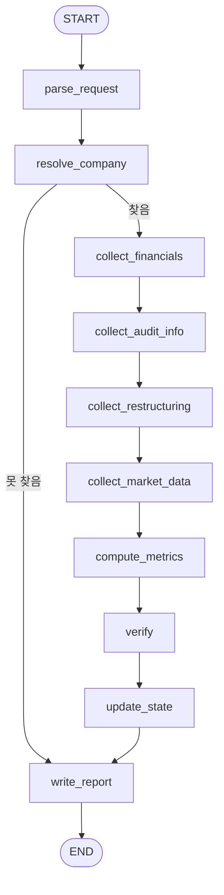

# 재무 건전성 에이전트 — 개발문서

> 문서 버전: v0.22 (2026-11-06) — 5단계 완료 기록(14장), 구조조정 정정은 같은 사건(8장)
> (v0.21 (2026-11-06) — 4단계 완료 기록(14장), 상태 키 `sources`(5장), 시장 데이터 경로 미구현 명시(8장), `ebitda_total`(12장)
> (v0.20 (2026-11-06) — 감가상각비는 사용권 포함 합계끼리 비교(9.1a), `무형자산감가상각` 행 분류(9.1a)
> (v0.19 (2026-11-06) — 12장 시그니처를 구현과 맞춤(`ttm_operating_cash_flow`는 해외 11.1, `amortization_sources`·`ebitda`·`ebitda_interest_coverage`), % 지표 단위 명시, 3단계 완료 기록(14장)
> (v0.18 (2026-11-06) — 이자비용 missing 사유 "이자비용 행 없음(차입원가 자본화 있음)"(9.1a, 13.2), 별도 기준 판정은 연결재무제표 절 문구를 쓰지 않음을 명시(9.1a), F-NOMARKET 정답지 상태(13.2)
> (v0.17 (2026-11-05) — 금융표에 이자비용 행이 없을 때 현금흐름 조정 표 + 다른 표 일치 채택, v0.16의 "이자비용 구성 불명확" 규칙 철회(9.1a, 13.1), F-NOINTEREST 조건 변경(13.2)
> (v0.16 (2026-11-05) — 주석에 리스부채 합계만 있을 때 재무상태표 합과 원 단위 대조(9.1, 9.1a), 이자비용 missing 사유 "이자비용 구성 불명확" 추가(9.1a, 13.2)
> (v0.15 (2026-11-05) — 별도재무제표만 있는 기업의 주석 출처와 "별도 기준" 표시(3.3, 9.1a, 사용자 결정), F-NOINTEREST·F-CORRECTED 추가(13.2)
> (v0.14 (2026-11-05) — 무형자산 변동표 출처 채택(9.1a), EBITDA 음수 시 EBITDA/이자비용 값 그대로 + note(3.2), 이자비용 missing 시험 이동(13.1·13.2)
> (v0.13 (2026-11-05) — 9.1·9.1a 출처를 ZIP 전체로 확장(본문 + 연결감사보고서 첨부 재무제표·주석, 별도 감사보고서 제외), 주석 번호 열 처리, 무형자산 변동표 출처 제안(미채택), F-NEGEBITDA 이자비용 기대값 변경(13.2)
> (v0.12 (2026-11-05) — 금융원가 주석 이자비용 출처 채택(2개 표 이상 일치, 9.1a), F-NORMAL 보조 케이스 역할 변경(13.2), `human_verified`
> (v0.11 (2026-11-05) — EBITDA/이자비용 missing 사유 문구 "현금흐름 조정 항목에 이자비용 행 없음"(3.2, 13.2), 금융원가 주석 이자비용 출처 제안(9.1a, 미채택)
> (v0.10 (2026-11-05) — F-NORMAL 조건 변경(13.2), 9.1a C 출처 규칙 보완(주석에 감가상각 행이 없으면 본문 값만), 감사의견 당기 행 판정 = 첫 기수(8장·9.2)
> (v0.9 (2026-11-05) — `fin.short_term_financial_assets`: 행 없고 기타유동금융자산도 없으면 0, 기타유동금융자산 행만 있으면 missing(`fin.net_debt`와 같은 규칙, 3.2·9.1). F-NETCASH 조건에 EBITDA 산출 추가, F-NETCASH-NOEBITDA 신설(13.2)
> (v0.8 (2026-11-05) — 1단계 마무리 결정 반영: 최신 보고서 리스부채 0은 직전 사업보고서에도 없을 때만(그 외 "최신 보고서 리스부채 미공시" missing, 9.1), 사용권자산 포함 유형자산 태그를 사용권자산 신호로(9.1), `ifrs-full_OtherCurrentFinancialAssets` 계속 제외 확정(9.1), 영업현금흐름 사업연도 값 출력(3.1, 화면 대표 차트 전환용), F-NETCASH 조건 "순차입금 < 0"(13.2), 구조조정 보고서명 확정(9.3), 감사의견 문자열 실측 반영(9.2)
> (v0.7 (2026-11-05) — 리스부채 채택 규칙(BS 행 → 주석 대조, 없으면 리스 주석 값, BS 사용권자산·주석 리스 절 모두 없을 때만 0, 그 외 missing)·이중 합산 방지(9.1), `total_borrowings` 시그니처(12장)·테스트(13.1)
> (v0.6 (2026-11-05) — 순차입금 A안 확정(한국기업평가 정의), 리스부채 0 처리 폐기(사용권자산 신호 있고 리스부채 행 없으면 missing), 순차입금·총차입금·부채비율 최신 정기보고서 기준 추가(3.1 기준 보고서 선택 규칙)
> (v0.5 (2026-11-05) — 총차입금에 유동·비유동 리스부채 전체 포함(STRIDE 정의), 순차입금 현금성자산 범위는 A/B안 비교 후 결정 대기(methodology '확인 중'), 정정 판정 공시 목록 기간 미포함 시 오류 중단(7장)
> (v0.4 (2026-11-05) — EBITDA를 STRIDE 정의로(감가상각비에 사용권자산 포함), 상각비를 사업보고서 연결 주석(N)·현금흐름(C) 2출처 대조로 읽음(9.1a), 무형자산상각비 미발견 시 BS 무형자산 규칙, XBRL은 참고만(12장)
> (v0.3 (2026-11-04) — 1단계 API 확인 반영(표본 8곳, `core/docs/api_fields.md`): 계정을 개념별 account_id 허용목록+sj_div로 매칭(9.1), 총차입금은 차입·사채 행이 모두 분류될 때만 계산·리스부채 제외, EBITDA 상각비는 CF 조정항목 정확한 ID만(없으면 "상각비 미공시" missing), 이자비용 대체 금지, 감사의견 응답 그대로 출력·연결/별도 구분 제거·범위제한 판별 불가 시 unknown(9.2), 정정공시 unknown 규칙(7장), 시점 판정 list.json rcept_dt
> (v0.2 (2026-11-04) — 확인되지 않은 정보 제거: 신용평가 구간 표시(map_bands·classify_industry)를 Phase 2로, 핵심 지표 정의를 원문 확인된 한국기업평가 「주요 재무지표의 정의」로 교체(기간: 최근 사업연도), Altman Z를 Phase 2로, 코스닥 자기자본 지표 추가
> (v0.1 (2026-11-04) — 최초 작성)
> 대상 독자: 이 문서만 보고 코드를 작성할 개발자 또는 코딩 AI
> 관련 문서: `STRIDE_MVP_구성문서_v1.5.md`, `해외진출_자금수요_기업발굴_에이전트_개발문서.md`(v0.7), `공통기준/metrics_catalog.yaml`(v0.10)
> agent_key: `financial_health` · 지표 약어: `fin`
> 따르는 공통 양식: `공통기준/skills/stride-agent-dev-standard` (공통 스키마, core 모듈, 근거 ID, LLM 호출, 테스트 규칙)

---

## 0. 이 문서를 읽는 AI에게

1. **문서에 정의된 노드, 엣지, 스키마, 함수, metric_id 이름을 바꾸지 않는다.** 오케스트레이터와 해외진출 에이전트가 같은 이름을 쓴다.
2. **`※확인` 항목은 추측해서 채우지 않는다.** `TODO(확인 필요)`로 남기고 14장 1단계에서 실제 응답으로 확정한다.
3. **판단하지 않는다.** 이 에이전트는 "양호/위험", 등급, 점수, 결격 여부를 만들지 않는다. 출력은 수치, 근거, 규칙 분류(감사의견 값 등)뿐이다. 결격·주의 규칙 적용은 오케스트레이터 `apply_rules`가 한다.
4. **확인되지 않은 정보는 출력하지 않는다.** 원문으로 확인하지 못한 구간·임계값·방법론 이름은 쓰지 않는다. MVP는 구간(band)을 출력하지 않는다(모든 Metric.band=None). 신용평가사 기준표 구간 표시는 Phase 2.
5. **산식은 원문에서 확인한 정의를 그대로 쓰고, 원문과 다른 부분은 `note`에 사실대로 적는다.** 예: 한국기업평가 정의의 EBIT 자리에 영업이익을 쓴 것. 원문이 없는 산식은 `methodology="STRIDE 정의: <산식>"`으로 산식 자체를 적는다.
6. **모든 수치는 evidence_id를 가진다.** 재무 계정은 `FIN:{rcept_no}:{fs_div}:{account_id}`, 계산값은 `CALC:{run_id}:{metric_id}`.
7. **as_of 이후 접수된 보고서는 쓰지 않는다.** 재무제표는 사업연도가 아니라 **보고서 접수일** 기준으로 고른다.
8. **이 에이전트는 LLM을 쓰지 않는다.** 보고서(`write_report`)도 템플릿으로 만든다. 구독 사용량을 해외진출 에이전트에 남기기 위함이다.
9. **결측은 0으로 채우지 않는다.** 계정을 찾지 못하면 None, `data_status="missing"`, note에 사유, open_questions에 기록한다. 값이 있었지만 as_of 시점 원본을 확인할 수 없으면(정정공시, 7장) `data_status="unknown"`, note "정정 전 원본 값 확인 불가". 화면은 missing을 "산출 불가", unknown을 "확인 불가"로 표시하고 note를 함께 보여준다.
10. **특정 기업명·종목코드를 코드·설정·예시에 넣지 않는다.** 테스트 기업은 `tests/golden/financial_health/`에만 둔다.
11. 작업 순서는 14장을 따른다.

---

## 1. 목적과 범위

### 1.1 목적

국내 상장사 1곳의 재무 상태를 **원문으로 확인한 산식으로 계산한 수치와 근거**로 제공한다. 핵심 지표 정의는 한국기업평가 「주요 재무지표의 정의」(공개 페이지, 2026-11-04 원문 확인)를 따르고, 상장 유지 규정 판단에 쓰이는 입력값(감사의견, 자본잠식률, 자기자본)은 한국거래소 KIND 공시가이드(2026.2.2, 유가증권·코스닥 원문 확인)를 따른다. 회생·워크아웃 관련 공시는 공시명 사실로만 제공한다. 해외진출 에이전트의 자금 공백 계산에 쓰이는 재무 기본 항목(현금, 단기금융상품, TTM 영업현금흐름)의 정의도 이 에이전트가 소유한다.

### 1.2 실행 모드

| 모드 | 입력 | 출력 | 용도 |
|---|---|---|---|
| `single` | 기업 1곳 + as_of | 기업 재무 결과 1건 (`AgentResult`) | 요청형(review_graph), 조건 탐색 배치의 기업 단위 실행, 개발·테스트 |
| `batch` | (공통 Request에 corp_code 목록이 없으므로) 오케스트레이터가 기업별 `single` Request를 `Send`로 보냄 | 기업별 `AgentResult` (순위 없음) | discover_graph·monitor_graph |

이 에이전트는 자체 후보 선별(BatchGraph)을 두지 않는다. 기업 목록은 오케스트레이터가 정하고, 기업별 `single` 실행 결과를 오케스트레이터가 모은다. CLI의 `batch`는 테스트 편의용으로 corp_code 목록을 받아 같은 일을 한다.

### 1.3 범위 밖

- 결격·주의 판정, 종합 의견, 투자 적합성 (오케스트레이터)
- 차입금 만기 구조, 계속기업 불확실성 문단, 우발채무 (주석·감사보고서 원문 파싱 필요 → `needs_due_diligence`)
- 신용평가 3사의 실제 신용등급 (공개 API 없음 → Phase 2. MVP는 `needs_due_diligence`)
- 신용평가사 기준표 구간 표시(band): 업종별 방법론과 원문 경계값을 확보하지 못함 → Phase 2
- Altman Z-score: 국내 기업 적용 근거와 원 논문 구간 대조 전 → Phase 2
- 밸류에이션 판단 (시가 기반 지표는 값만 제공)

---

## 2. 데이터 출처와 접근성

| 데이터 | 출처·API·문서명 | 접근 방법 | 갱신 주기 | 시점 필터 기준 | 접근 확인 상태 |
|---|---|---|---|---|---|
| 재무제표 (BS·IS/CIS·CF) | OpenDART `fnlttSinglAcntAll.json` | API 키 (보유) | 정기보고서 접수 시 | 보고서 `rcept_dt` ≤ as_of (list.json) | 확인됨 (2026-11-04, 표본 8곳. 정정 후 최신본만 반환 → 7장) |
| 정기보고서 목록 | OpenDART `list.json` (`pblntf_ty=A`) | API 키 | 수시 | `rcept_dt` ≤ as_of | 확인됨 (2026-11-04) |
| 감사의견 | OpenDART 정기보고서 주요정보 `accnutAdtorNmNdAdtOpinion.json` (회계감사인의 명칭 및 감사의견) | API 키 | 사업·반기보고서 | 보고서 `rcept_dt` ≤ as_of | 확인됨 (2026-11-05: 한정·의견거절 문자열 확인. 부적정은 미확인, 9.2) |
| 회생·워크아웃·파산 공시 | OpenDART `list.json` 보고서명 패턴 (9.3) | API 키 | 수시 | `rcept_dt` ≤ as_of | 확인됨 (2026-11-05, 5년 스캔. 9.3) |
| 시가총액 ① | KRX OPEN API 유가증권·코스닥 일별 시세 | 키 + API별 이용 승인 | 영업일 | `basDd` ≤ as_of 중 최신 | ※확인 (승인 여부) |
| 시가총액 ② | 공공데이터포털 「금융위원회_주식시세정보」 | 활용 신청 (개발계정 자동승인) | 다음 영업일 13시 이후 | `basDt` ≤ as_of 중 최신 | ※확인 |
| 지표 정의 | 한국기업평가 「주요 재무지표의 정의」 http://www.korearatings.com/cms/frDisclosureCon/finaIndicatorsPop.do | 공개 웹페이지 | 개정 시 | — | 확인됨 (2026-11-04: EBITDA, 순차입금, EBITDA/금융비용, EBITDA 마진, 부채비율, 차입금의존도) |
| 자본잠식률 산식·상장 규정 입력 | 한국거래소 KIND 「유가증권시장 공시가이드」·「코스닥시장 공시가이드」(2026.2.2 게시) | 공개 PDF | 개정 시 | 게시일 | 확인됨 (2026-11-04 원문 확인) |
| 신용등급 | 신용평가 3사 웹사이트 | 공개 API 없음 | — | — | 불가 → `needs_due_diligence` |

---

## 3. 출력 지표 정의

모든 항목은 `공통기준/metrics_catalog.yaml` v0.10에 등록되어 있다. 정의·계산식은 목록이 기준이며 아래 표는 요약이다.

### 3.1 기간 규칙

| 구분 | 기간 | 근거 |
|---|---|---|
| 핵심·보조 지표 | 최근 사업연도 (as_of 이전 접수된 최신 **사업보고서**). 최근 3개 사업연도 값을 연도별로 함께 출력(평균 내지 않음) | 한국기업평가 정의 페이지에 기간 규정 없음 → 연도별 값 그대로 제공 |
| 재무 기본 항목(현금·단기금융상품·TTM 영업현금흐름) | as_of 이전 접수된 최신 **정기보고서**(분기 포함) | 해외진출 에이전트 자금 공백 계산용 |
| 상장 규정 입력(자본잠식률·자기자본·감사의견) | 최근 사업연도말 | KIND 공시가이드 |
| 순차입금·총차입금·부채비율 (v0.6) | 사업연도별(사업보고서) **+ 최신 정기보고서 기준** | 기준 보고서 선택 규칙: as_of 이전 접수(rcept_dt)된 정기보고서 중 최신 1건(분기·반기·사업보고서 중 가장 늦게 접수된 것)의 재무상태표로 같은 산식을 한 번 더 계산해 `Metric.period="{YYYY}{Q1/H1/Q3/FY}말"`로 출력. `fin.ttm_operating_cash_flow`와 같은 보고서를 쓴다(화면 대표 차트 기준일 맞춤). 새 metric_id는 만들지 않는다. 최신 보고서가 사업보고서면 사업연도 값과 같다 |
| 영업현금흐름 사업연도 값 (v0.8) | 사업연도별(사업보고서) | `fin.ttm_operating_cash_flow`를 `Metric.period="2025FY"`로 한 번 더 출력한다(값 = 사업보고서 연간 영업활동현금흐름. 12장 함수의 "최신 보고서가 사업보고서면 연간값 그대로"와 같은 계산). 새 metric_id는 만들지 않는다. 최신 순차입금이 "최신 보고서 리스부채 미공시"일 때 화면 대표 차트가 쓴다 (화면 명세 4.1) |

연도별 값은 `Metric.period="2025FY"`처럼 연도마다 별도 Metric으로 출력한다. 화면 기본 표시는 최근 사업연도 값이다.

### 3.2 Metric

| metric_id | 지표명 | 계산식 | 단위 | 기간 | methodology (출력 문자열) | data_status 규칙 |
|---|---|---|---|---|---|---|
| `fin.cash_and_equivalents` | 현금및현금성자산 | BS 현금및현금성자산 | 원 | 최신 정기보고서 | K-IFRS 재무상태표 계정 | 계정 없으면 missing |
| `fin.short_term_financial_assets` | 단기금융상품 | BS `ifrs-full_ShorttermDepositsNotClassifiedAsCashEquivalents` (9.1) | 원 | 최신 정기보고서 | K-IFRS 재무상태표 계정 (account_id ifrs-full_ShorttermDepositsNotClassifiedAsCashEquivalents) | 행 없고 `ifrs-full_OtherCurrentFinancialAssets` 행도 없으면 value=0, note "단기금융상품 행 없음". 기타유동금융자산 행만 있으면 missing, note "단기금융상품 행 없음, 기타유동금융자산 행 있음". 단기금융상품 행의 금액이 비면 missing (`fin.net_debt`와 같은 규칙) |
| `fin.ttm_operating_cash_flow` | 최근 4분기 영업활동현금흐름 | 12장 | 원 | TTM + 사업연도별 (3.1) | K-IFRS 현금흐름표, 누적값 차감 | 입력 3개 중 하나라도 없으면 missing |
| `fin.ebitda` | EBITDA | 영업이익 + 감가상각비(사용권자산 감가상각 포함) + 무형자산상각비. 상각비는 9.1a (사업보고서 연결 주석·현금흐름 2출처 대조) | 원 | 사업연도별 | STRIDE 정의: 영업이익 + 감가상각비(사용권자산 감가상각 포함) + 무형자산상각비. 참고: 한국기업평가 「주요 재무지표의 정의」 EBITDA = EBIT+감가상각비+무형자산상각비, EBIT = 매출액-매출원가-판관비 (사용권자산 언급 없음, 2026-11-05 원문 확인) | 영업이익 없으면 missing. 상각비 출처 불일치·비원화·무형자산상각비 미공시(9.1a)면 missing (note에 사유) |
| `fin.total_borrowings` | 총차입금 | BS 차입금·사채·리스부채 허용목록(9.1) 행의 합. 유동·비유동 리스부채 전체 포함 | 원 | 사업연도별 + 최신 정기보고서 (3.1) | STRIDE 정의: 재무상태표 차입금·사채 허용목록 계정 + 유동·비유동 리스부채 전체. 참고: 한국기업평가 「주요 재무지표의 정의」는 차입금 구성에 금융리스부채·유동성금융리스미지급금을 포함(K-IFRS 1116 이전 용어) | **차입·사채·리스부채 계열 행(9.1 탐지 규칙)이 전부 허용목록으로 분류되고 금액이 있을 때만 계산.** 하나라도 미분류·빈 금액이면 missing, note "미분류 차입 계정: {account_nm}". 계열 행이 하나도 없으면 value=0, note "차입금 계정 없음". note에 포함한 리스부채 금액을 적는다. **리스부채는 9.1 채택 규칙**(BS 행 → 주석 대조 / BS 행 없으면 리스 주석 값 / BS 사용권자산·주석 리스 절 모두 없을 때만 0 / 그 외 missing "리스부채 확인 불가"). note에 리스부채 출처를 적는다 |
| `fin.net_debt` | 순차입금 | fin.total_borrowings − (현금및현금성자산 + 단기금융상품). 단기금융상품 행(`ifrs-full_ShorttermDepositsNotClassifiedAsCashEquivalents`) 있으면 사용, 그 행이 없고 기타유동금융자산(`ifrs-full_OtherCurrentFinancialAssets`)도 없으면 0, 기타유동금융자산만 있으면 missing | 원 | 사업연도별 + 최신 정기보고서 (3.1) | 한국기업평가 「주요 재무지표의 정의」 (2026-11-05 원문 확인): 순차입금 = 총차입금-현금성자산, 현금성자산 = 현금및현금등가물+단기금융상품 등. 총차입금의 리스부채 포함 부분은 STRIDE 정의 (fin.total_borrowings) | 구성 중 missing 있으면 missing. note "단기금융상품 행 없음, 기타유동금융자산 행 있음" |
| `fin.net_debt_to_ebitda` | 순차입금/EBITDA | fin.net_debt / fin.ebitda | 배 | 사업연도별 | STRIDE 정의: fin.net_debt / fin.ebitda (EBITDA는 STRIDE 정의) | EBITDA ≤ 0이면 value=None, note "EBITDA ≤ 0으로 계산 안 함" |
| `fin.ebitda_interest_coverage` | EBITDA/이자비용 | fin.ebitda / 이자비용 (CF `dart_AdjustmentsForInterestExpenses`, 없으면 금융원가 주석, 9.1a) | 배 | 사업연도별 | STRIDE 정의: EBITDA/이자비용. note: "한국기업평가 EBITDA/금융비용과 분모가 다름(매출채권처분손실·자본화된 이자비용 미포함)" | 두 출처에서 값을 얻지 못하면 missing, note "이자비용 확인 불가: {사유}" (9.1a). **금융비용(`ifrs-full_FinanceCosts`)·이자지급액(`InterestPaid…`)으로 대체하지 않는다.** 이자비용 0이면 value=None, note "이자비용 없음". EBITDA가 음수면 값을 그대로 출력하고 note "EBITDA 음수" (STRIDE 정의, 2026-11-05 결정. `fin.net_debt_to_ebitda`는 기존대로 None) |
| `fin.ebitda_margin` | EBITDA 마진 | fin.ebitda / 매출액 × 100 | % | 사업연도별 | STRIDE 정의: fin.ebitda / 매출액 × 100 (EBITDA는 STRIDE 정의. 산식 형태는 한국기업평가 EBITDA MARGIN과 같음) | 매출액 0·missing이면 missing |
| `fin.debt_ratio` | 부채비율 | 부채총계 / 자본총계 × 100 | % | 사업연도별 + 최신 정기보고서 (3.1) | 한국기업평가 「주요 재무지표의 정의」 부채비율 = (부채총계/자본총계)*100 (2026-11-05 원문 재확인) | 계정 없으면 missing. 자본총계 ≤ 0이면 value=None, note "자본총계 ≤ 0" |
| `fin.borrowing_dependency` | 차입금의존도 | fin.total_borrowings / 자산총계 × 100 | % | 같음 | 한국기업평가 「주요 재무지표의 정의」(차입금/자산총계). 차입금 = fin.total_borrowings | 같음 |
| `fin.current_ratio` | 유동비율 | 유동자산 / 유동부채 × 100 | % | 같음 | STRIDE 정의: 유동자산/유동부채×100 | 같음 |
| `fin.capital_impairment_ratio` | 자본잠식률 | (자본금 − 자기자본) / 자본금 × 100. 연결이면 자기자본에서 비지배지분 제외 | % | 최근 사업연도말 | 한국거래소 KIND 유가증권·코스닥 공시가이드(2026.2.2) | 자본금 없으면 missing |
| `fin.equity_ex_nci` | 자기자본 (비지배지분 제외) | 연결: 지배기업 소유주지분, 별도: 자본총계 | 원 | 최근 사업연도말 | 한국거래소 KIND 코스닥 공시가이드(2026.2.2) 자기자본 기준의 입력 | 계정 없으면 missing |
| `fin.market_cap` | 시가총액 (선택) | API 제공값. 없으면 같은 날짜 종가 × 상장주식수 | 원 | as_of 이하 최신 거래일 | 거래소 시가총액 | 시장 데이터 키가 없거나 조회 실패면 missing |
| `fin.net_debt_to_ev` | 순차입금/EV (선택) | fin.net_debt / (fin.market_cap + fin.net_debt) | 비율 | as_of | STRIDE 정의: 산식 그대로 | 시가총액 missing이면 missing |
| `fin.per` | PER (선택) | fin.market_cap / 지배주주순이익 | 배 | as_of, 최근 사업연도 | STRIDE 정의: 산식 그대로 | 순이익 ≤ 0이면 value=None |
| `fin.pbr` | PBR (선택) | fin.market_cap / 지배주주지분 | 배 | as_of | STRIDE 정의: 산식 그대로 | 같음 |
| `fin.ev_to_ebitda` | EV/EBITDA (선택) | (fin.market_cap + fin.net_debt) / fin.ebitda | 배 | as_of | STRIDE 정의: 산식 그대로 | EBITDA ≤ 0이면 None |
| `fin.debt_maturity_profile` | 차입금 만기 구조 | — | — | — | — | 항상 `needs_due_diligence` |
| `fin.going_concern_note` | 계속기업 불확실성 문단 | — | — | — | — | 항상 `needs_due_diligence` |
| `fin.credit_rating` | 신용등급 | — | — | — | — | 항상 `needs_due_diligence` |

모든 Metric의 `band`는 None이다. 7장 정정 규칙으로 해당 연도 보고서가 unknown이면 그 연도의 모든 지표는 `data_status="unknown"`, note "정정 전 원본 값 확인 불가". `needs_due_diligence` 지표는 value=None, evidence_ids에 해당 사업보고서 근거(`DART:{rcept_no}:document`) 1개를 넣는다.

### 3.3 Classification (규칙 분류)

| key | 값 | 규칙 |
|---|---|---|
| `fin.audit_opinion` | 응답 문자열 그대로 / missing / unknown | 최근 사업연도 사업보고서 감사의견 API(9.2)의 당기 행 `adt_opinion` 문자열을 **앞뒤 공백만 제거해 그대로** 출력. 당기 행이 여러 개면 서로 다른 값마다 Classification 1개(같은 값은 1개로). **연결·별도 구분은 하지 않는다** (API에 구분 필드 없음). rule에 `bsns_year=<요청 파라미터>, reprt_code=11011`. 정규화(`AUDIT_OPINION_MAP`)는 오케스트레이터 규칙 입력용으로 rule에 함께 적고, 매핑에 없는 문자열은 rule에 "미매핑" |
| `fin.audit_scope_limitation` | true / false / unknown | `adt_opinion` 또는 `adt_reprt_spcmnt_matter`에 "범위제한"·"감사범위" 문구가 있으면 true. 의견이 적정 계열(`AUDIT_OPINION_MAP["적정"]`)이면 false. 그 외(한정·미매핑 등에서 문구 없음)는 **unknown** — API에 감사범위 제한 전용 필드가 없다. unknown이면 오케스트레이터 R1b-KS·R1-KQ의 해당 부분은 "확인 불가" (오케스트레이터 5장) |
| `fin.restructuring_status` | 없음 / 회생절차 / 워크아웃 / 파산 / 기타 구조조정 | as_of 이전 24개월 공시 목록의 보고서명이 9.3 패턴에 맞는지. 개시 후 종결·폐지 공시가 있으면 '없음'으로 되돌리지 않고 value + note에 "종결 공시 있음(YYYY-MM-DD)" |
| `fin.market_data_source` | krx_open_api / data_go_kr_stock_price / missing | fin.market_cap을 가져온 경로 |
| `fin.fs_basis` | CFS / OFS | 사용한 재무제표 구분. 연결 우선, 연결이 없으면 별도. OFS면 재무 지표 note 앞에 "별도 기준"을 붙인다 (v0.15). 주석 값이 필요한 지표는 9.1a 별도 기준 조건을 통과해야 한다 |

---

## 4. 데이터 모델 (`agents/financial_health/schemas.py`)

공통 스키마(`Request`, `Evidence`, `Metric`, `Classification`, `Finding`, `Alert`, `AgentResult`)는 공통 양식 3장을 따른다. 아래는 이 에이전트 전용 모델만이다.

```python
from datetime import date
from typing import Literal
from pydantic import BaseModel, Field

class PeriodicReport(BaseModel):
    """as_of 이전에 접수된 정기보고서 1건."""
    rcept_no: str
    rcept_dt: date
    report_kind: Literal["annual", "half", "q1", "q3"]
    bsns_year: int
    reprt_code: str                      # 11011/11012/11013/11014
    is_correction: bool = False
    evidence_ids: list[str] = Field(min_length=1)

class AccountValue(BaseModel):
    """재무제표 계정 1개 값."""
    key: str                             # 9.1 계정 키 (예: "operating_income")
    account_id: str | None
    account_nm: str
    fs_div: Literal["CFS", "OFS"]
    sj_div: str                          # BS/IS/CIS/CF
    period_label: str                    # "2025FY", "2026H1 누적" 등
    amount: int | None                   # 원 단위
    rcept_no: str
    evidence_ids: list[str] = Field(min_length=1)

class FinancialYear(BaseModel):
    """사업연도 1개의 계정 묶음."""
    bsns_year: int
    fs_div: Literal["CFS", "OFS"]
    accounts: dict[str, AccountValue]    # key → 값
    rcept_no: str
    evidence_ids: list[str] = Field(min_length=1)

class MarketSnapshot(BaseModel):
    base_date: date
    market_cap: int | None
    close_price: int | None
    listed_shares: int | None
    source: Literal["krx_open_api", "data_go_kr_stock_price", "missing"]
    evidence_ids: list[str] = Field(min_length=1)

class RestructuringEvent(BaseModel):
    rcept_no: str
    rcept_dt: date
    report_nm: str
    kind: Literal["회생절차", "워크아웃", "파산", "기타 구조조정", "종결"]
    evidence_ids: list[str] = Field(min_length=1)
```


---

## 5. 그래프 상태 (`state.py`)

```python
from typing import Annotated, TypedDict
import operator
from core.schemas import Request, Evidence, Metric, Classification, Finding, Alert
from agents.financial_health.schemas import (
    PeriodicReport, FinancialYear, AccountValue, MarketSnapshot, RestructuringEvent)

class FinancialHealthState(TypedDict, total=False):
    # 입력 (덮어쓰기)
    request: Request
    run_id: str
    company: dict | None                 # {"corp_code", "corp_name", "stock_code", "market"}

    # 수집 (덮어쓰기)
    reports: list[PeriodicReport]        # as_of 이전 정기보고서, 접수일 내림차순
    years: list[FinancialYear]           # 최근 3개 사업연도 (사업보고서 기준)
    latest_periodic: dict[str, AccountValue] | None   # 최신 정기보고서(분기 포함) 계정
    sources: dict                        # v0.21: 노드 사이 원자료 (재무 행, 리스·상각비·이자비용 판독 결과, 공시 목록). 저장하지 않는다
    audit: list[Classification]
    restructuring: list[RestructuringEvent]
    market: MarketSnapshot | None

    # 계산 (덮어쓰기)
    metrics: list[Metric]
    classifications: list[Classification]

    # 누적 (operator.add)
    evidence: Annotated[list[Evidence], operator.add]
    open_questions: Annotated[list[str], operator.add]
    errors: Annotated[list[str], operator.add]

    # 결과 (덮어쓰기)
    findings: list[Finding]
    alerts: list[Alert]
    report_markdown: str | None
```

---

## 6. 그래프 구조



| # | 노드 | 종류 | LLM | 다음 노드 |
|---|---|---|---|---|
| 1 | `parse_request` | 코드 | X | `resolve_company` |
| 2 | `resolve_company` | 코드 (core 공통 함수) | X | 조건: `collect_financials` / `write_report` |
| 3 | `collect_financials` | 코드 (DART) | X | `collect_audit_info` |
| 4 | `collect_audit_info` | 코드 (DART) | X | `collect_restructuring` |
| 5 | `collect_restructuring` | 코드 (DART 목록) | X | `collect_market_data` |
| 6 | `collect_market_data` | 코드 (KRX → 공공데이터, 선택) | X | `compute_metrics` |
| 7 | `compute_metrics` | 코드 (`core.calc`) | X | `verify` |
| 8 | `verify` | 코드 | X | `update_state` |
| 9 | `update_state` | 코드 (SQLite) | X | `write_report` |
| 10 | `write_report` | 코드 (템플릿) | X | `END` |

**점수·순위·결격 판정·구간 매핑 노드는 없다.** (v0.1의 `classify_industry`, `map_bands`는 Phase 2) 재추출 루프도 없다(LLM 추출이 없으므로). `verify` 실패 항목은 해당 Metric의 data_status를 missing으로 바꾸고 errors에 남긴다.

```python
def route_after_resolve(state: FinancialHealthState) -> str:
    return "collect_financials" if state.get("company") else "write_report"

def build_graph():
    g = StateGraph(FinancialHealthState)
    for name in ["parse_request", "resolve_company", "collect_financials", "collect_audit_info",
                 "collect_restructuring", "collect_market_data",
                 "compute_metrics", "verify", "update_state", "write_report"]:
        g.add_node(name, NODES[name])
    g.add_edge(START, "parse_request")
    g.add_edge("parse_request", "resolve_company")
    g.add_conditional_edges("resolve_company", route_after_resolve,
                            {"collect_financials": "collect_financials", "write_report": "write_report"})
    chain = ["collect_financials", "collect_audit_info", "collect_restructuring",
             "collect_market_data", "compute_metrics", "verify", "update_state", "write_report"]
    for a, b in zip(chain, chain[1:]):
        g.add_edge(a, b)
    g.add_edge("write_report", END)
    return g.compile()

# build_batch_graph()는 두지 않는다 (1.2). 동시 실행 수는 오케스트레이터 config FIN_CONCURRENCY.
```

`to_result(state) -> AgentResult`는 `graph.py`에 두고 반환 전에 `core.evidence.validate_evidence`, `core.catalog.validate`를 호출한다. `AgentResult.extra`에는 `{"years": [...연도별 계정 요약...], "market": {...}}`를 넣는다.

---

## 7. 시점 통제 (as_of)

| 경로 | 규칙 | 구현 위치 |
|---|---|---|
| 정기보고서 선택 | list.json `rcept_dt ≤ as_of` (**시점 판정은 rcept_dt만**, rcept_no 앞 8자리는 쓰지 않음). 사업연도가 아니라 접수일 기준 | `collect_financials`, `core.asof.filter_asof` |
| 정정공시 (v0.3) | fnlttSinglAcntAll·감사의견 API는 정정 후 최신본만 준다. 응답 `rcept_no`가 as_of 이하 목록에 있으면(as_of가 오늘이면 항상) 그 값을 쓴다. 없으면(원본 접수 ≤ as_of < 정정 접수) 원본의 list.json 정보(접수번호, 보고서명, 접수일)만 쓰고 그 보고서의 계정·감사의견 값은 `unknown`, note "정정 전 원본 값 확인 불가". 판정 함수 `core.asof.resolve_version` (해외진출 개발문서 6.1과 같음). 판정에 쓰는 공시 목록(`list_filings` 결과 `FilingList`)의 조회 기간이 대상 원공시·보고서의 `rcept_dt`를 포함하지 않으면 unknown으로 두지 않고 `CoverageError`로 중단한다 (2026-11-05 결정. 목록 기간 밖 보고서가 정정 여부와 무관하게 unknown으로 잘못 판정되는 것을 막음). 클라이언트는 API 호출 전에 검사한다. 원문 파싱은 Phase 2 | `collect_financials`, `collect_audit_info` |
| 재무 계정 값 | 위에서 고른 보고서의 `rcept_no` 응답만 사용. 다른 보고서의 `frmtrm_amount`(전기 값)로 과거 연도를 채우지 않는다(정정 반영 시점이 다름) | `collect_financials` |
| 감사의견 | 위에서 고른 사업보고서의 rcept_no 기준 값만 | `collect_audit_info` |
| 회생·워크아웃 공시 | `rcept_dt ≤ as_of` | `collect_restructuring` |
| 시가총액 | 기준일 ≤ as_of 중 최신 거래일. 공공데이터포털은 다음 영업일 13시 이후 갱신이므로 as_of가 오늘이면 직전 거래일 값 | `collect_market_data` |
| LLM 사전 지식 | 해당 없음 (LLM 미사용) | — |

---

## 8. 노드 명세

```python
def parse_request(state) -> dict:
    """Request를 검증하고 run_id를 만든다.
    입력 키: request / 쓰는 키: run_id, errors(+)
    처리: 1. agent == "financial_health" 확인 2. as_of가 미래면 오늘로 바꾸고 errors 기록 3. run_id 생성 (공통 형식)
    LLM: 없음. 실패: errors 기록 후 계속.
    """

def resolve_company(state) -> dict:
    """core.company.resolve(company or corp_code)로 기업을 확정한다 (해외진출 에이전트와 같은 공통 함수).
    입력 키: request / 쓰는 키: company, errors(+)
    처리: 1. corp_code가 있으면 그대로 2. 없으면 이름·종목코드로 조회 3. 상장사가 아니면 company=None, errors "비상장"
       4. company.json으로 market 채움 (KOSPI/KOSDAQ: 오케스트레이터 규칙이 시장별로 다름)
    실패: 후보 0개·2개 이상이면 company=None (오케스트레이터가 되묻기를 담당)
    """

def collect_financials(state) -> dict:
    """as_of 이전 접수된 정기보고서를 고르고 재무 계정을 가져온다.
    입력 키: company, request.as_of / 쓰는 키: reports, years, latest_periodic, evidence(+), open_questions(+), errors(+)
    처리:
        1. list.json(pblntf_ty=A)로 최근 4년 정기보고서 목록 조회 → rcept_dt ≤ as_of 만 남김.
        2. 사업보고서 최근 3개, 최신 정기보고서 1개(분기 포함)를 고른다.
        3. 각 보고서에 fnlttSinglAcntAll(fs_div=CFS) 호출. 연결이 없으면 OFS. 연도마다 fs_div를 기록.
           한 기업 안에서 연도별 fs_div가 다르면 open_questions에 "연결·별도 혼재" 기록.
        4. 9.1 허용목록(sj_div + account_id)으로 AccountValue를 만든다. account_nm 부분일치 대체는 쓰지 않는다.
           응답 rcept_no가 7장 정정 규칙으로 unknown이면 그 보고서의 AccountValue를 만들지 않고 연도 상태를 unknown으로 기록.
        5. 계정마다 Evidence(FIN:{rcept_no}:{fs_div}:{account_id or key}, grade A) 생성.
        6. 합계 검증용 계정(자산총계, 부채총계, 자본총계)도 함께 가져온다.
    LLM: 없음. 실패: 보고서 0개면 errors "정기보고서 없음", years=[]로 계속.
    """

def collect_audit_info(state) -> dict:
    """최근 사업보고서의 감사의견을 가져와 분류한다.
    입력 키: years(사업보고서 rcept_no) / 쓰는 키: audit, evidence(+)
    처리: 1. 감사의견 API(9.2) 호출 (bsns_year·reprt_code=11011은 요청 파라미터. 응답 bsns_year는 "제15기 (당기)" 같은 기수 문자열이라 쓰지 않음)
       2. 당기 행(응답 첫 행의 기수와 같은 행들. `(당기)` 대신 `(주1)`로 오는 경우가 있어 문자열 "당기"로 거르지 않는다, v0.10)의 adt_opinion을 그대로 fin.audit_opinion으로 (3.3). 연결·별도 구분 없음
       3. 3.3 규칙으로 fin.audit_scope_limitation (true/false/unknown)
       4. Classification + Evidence(DART:{rcept_no}:accnutAdtorNmNdAdtOpinion:adt_opinion)
    실패: 값 없으면 value="missing". 정정 규칙(7장)으로 unknown이면 value="unknown".
    """

def collect_restructuring(state) -> dict:
    """as_of 이전 24개월 공시 목록에서 회생·워크아웃·파산 관련 공시를 찾는다.
    입력 키: company, request.as_of / 쓰는 키: restructuring, evidence(+)
    처리: 1. list.json(corp_code, 기간 24개월, pblntf_ty 미지정) 2. report_nm을 RESTRUCTURING_PATTERNS(9.3)로 매칭. 정정 공시는 같은 사건이라 세지 않는다 (v0.22)
       3. RestructuringEvent 생성, 가장 최근 상태로 fin.restructuring_status 결정 (규칙: 3.3)
    LLM: 없음.
    """

def collect_market_data(state) -> dict:
    """as_of 기준 시가총액을 가져온다. ① KRX OPEN API ② 공공데이터포털 ③ missing 순서.
    입력 키: company.stock_code, company.market, request.as_of / 쓰는 키: market, classifications(+fin.market_data_source), evidence(+)
    처리: 1. as_of부터 최대 10영업일 전까지 거꾸로 조회해 첫 값 사용 2. 시가총액 필드가 없으면 종가 × 상장주식수
       3. Evidence(KRX:{basDd}:{isu_cd}:MKTCAP 또는 PUB:FSC:stockprice:{basDt}:{srtnCd})
    실패: 두 경로 모두 실패 → market.source="missing", 시장 지표는 compute_metrics에서 missing.
    현재 (v0.21): 시세 키가 없고 9.4 응답을 확인하지 못해 ①②를 구현하지 않았다. 항상 missing이다.
    """

def compute_metrics(state) -> dict:
    """3.2의 Metric을 core.calc 함수로 계산한다 (12장).
    입력 키: years, latest_periodic, market, audit, restructuring / 쓰는 키: metrics, evidence(+ CALC)
    처리: 1. 지표마다 metrics_catalog.yaml의 implementation 함수 호출 2. 계산 결과마다 CALC 근거 생성(meta에 입력 evidence_id와 수식)
       3. needs_due_diligence 지표 3개 추가 4. 0 나누기·음수 처리는 3.2 data_status 규칙
    LLM: 없음.
    """

def verify(state) -> dict:
    """계산 결과를 코드로 대조한다.
    입력 키: years, metrics, evidence / 쓰는 키: findings, metrics(data_status 갱신), errors(+)
    처리:
        1. 연도마다 자산총계 = 부채총계 + 자본총계 (허용 오차 config BS_TOLERANCE_KRW) 확인. 실패 연도의 지표는 missing으로.
        2. 모든 Metric evidence_ids 존재, 근거 published_at ≤ as_of.
        3. CALC 근거 재계산 일치.
        4. 금지 필드·평가어 검사 (core.report_guard).
    """

def update_state(state) -> dict:
    """결과를 저장하고 직전 상태와 비교해 사실 변화 Alert를 만든다 (10장).
    Alert 종류(ALERT_TYPES): audit_opinion_changed, impairment_crossed_50, impairment_crossed_100,
        equity_below_1bn, restructuring_filed, market_data_missing
    규칙: 직전 history(as_of < 이번 as_of 중 최신)와 비교. 좋고 나쁨을 적지 않고 "A → B"만 적는다.
    """

def write_report(state) -> dict:
    """템플릿(prompts가 아니라 templates/report.md.j2)으로 사실 요약을 만든다. LLM 없음.
    섹션: 기준 보고서 / 핵심 지표 3개(연도별 값·산식 출처) / 감사의견·자본잠식률·구조조정 공시 / 보조·시장 지표 / 실사 필요 항목 / 결측·주의(open_questions)
    판단 표현 금지 (core.report_guard 통과 필수).
    """
```

---

## 9. 외부 연동

### 9.1 OpenDART 재무제표 (`fnlttSinglAcntAll.json`)

파라미터·응답 필드는 해외진출 에이전트 개발문서 8.1.5와 같다(공통 클라이언트 `core/clients/dart.py`). 확인 기록: `core/docs/api_fields.md` 5장 (2026-11-04, 표본 8곳: 대형 2, 중형 3, 소형 3 / 유가증권 6, 코스닥 2).

**매칭 규칙 (v0.3): 개념별 `account_id` 허용목록 + `sj_div`로만 매칭한다.** account_nm 부분일치 대체는 쓰지 않는다. 허용목록에 없는 ID는 표본으로 확인한 뒤에만 추가한다(추가 시 `api_fields.md`에 확인 기업 수와 함께 기록). `IS`·`CIS`는 회사마다 하나만 나오므로 손익 계정은 둘 다 허용한다. 손익·현금흐름 계정은 `-표준계정코드 미사용-` 행을 쓰지 않는다.

| key | sj_div | 허용 account_id | 표본 확인 |
|---|---|---|---|
| cash | BS | `ifrs-full_CashAndCashEquivalents` | 8/8 |
| st_fin_assets | BS | `ifrs-full_ShorttermDepositsNotClassifiedAsCashEquivalents` | 4/8 ("단기금융상품"). `ifrs-full_OtherCurrentFinancialAssets`는 **제외 확정** (2026-11-05 결정): 계정명이 "단기금융자산"(1곳)·"기타유동금융자산"(4곳)으로 섞여 있고, 주석 구성 표가 있는 곳의 유동분은 미수금·대여금 등 예금 외 항목이다 (`api_fields.md` 16장). 이 행만 있으면 `fin.net_debt`는 missing |
| total_assets / total_liabilities / total_equity | BS | `ifrs-full_Assets` / `ifrs-full_Liabilities` / `ifrs-full_Equity` | 8/8 (`ifrs-full_Equity`는 SCE에도 여러 행 → BS만) |
| equity_parent | BS | `ifrs-full_EquityAttributableToOwnersOfParent` | 연결 8/8. 별도(OFS)에는 없음 → 별도는 total_equity |
| capital_stock | BS | `ifrs-full_IssuedCapital` | 8/8 |
| current_assets / current_liabilities | BS | `ifrs-full_CurrentAssets` / `ifrs-full_CurrentLiabilities` | 8/8 |
| retained_earnings | BS | `ifrs-full_RetainedEarnings` | 8/8 |
| revenue | IS·CIS | `ifrs-full_Revenue` | 8/8 (계정명 "매출액"·"수익(매출액)"·"수익" 등) |
| operating_income | IS·CIS | `dart_OperatingIncomeLoss` | 8/8 |
| net_income_parent | IS·CIS | `ifrs-full_ProfitLossAttributableToOwnersOfParent` | 연결 8/8 (`ComprehensiveIncomeAttributableToOwnersOfParent`와 계정명이 같으므로 ID 필수) |
| interest_expense | CF, 없으면 9.1a 금융원가 주석 | `dart_AdjustmentsForInterestExpenses` ("이자비용", "이자비용 조정") | 2/8, 주석 포함 6/9. **`ifrs-full_FinanceCosts`(금융비용·금융원가)와 `ifrs-full_InterestPaidClassifiedAs…`(이자의 지급)는 이자비용 대체로 쓰지 않는다** |
| depreciation | — | 9.1a (사업보고서 원문). fnlttSinglAcntAll CF `ifrs-full_AdjustmentsForDepreciationExpense`는 2/8만 있어 쓰지 않음 | — |
| amortization | — | 9.1a. fnlttSinglAcntAll CF `ifrs-full_AdjustmentsForAmortisationExpense`는 1/8만 있어 쓰지 않음 | — |
| intangible_assets (무형자산상각비 0 판정용) | BS | `ifrs-full_IntangibleAssetsOtherThanGoodwill`, `ifrs-full_IntangibleAssetsAndGoodwill` | 9/9 (둘 중 하나) |
| op_cash_flow | CF | `ifrs-full_CashFlowsFromUsedInOperatingActivities` | 8/8 |
| capex | CF | `ifrs-full_PurchaseOfPropertyPlantAndEquipmentClassifiedAsInvestingActivities` | 8/8 |

**차입금·사채 허용목록 (`fin.total_borrowings`, BS)**

| 구분 | 허용 account_id | 표본 확인 (계정명 예) |
|---|---|---|
| 단기차입금 | `ifrs-full_ShorttermBorrowings` | 6곳 ("단기차입금", "유동 차입금(사채 포함)", "차입부채") |
| 유동성 장기차입금·사채 | `ifrs-full_CurrentPortionOfLongtermBorrowings`, `ifrs-full_CurrentBorrowingsAndCurrentPortionOfNoncurrentBorrowings`, `dart_CurrentPortionOfNoncurrentBondsIssued` | 4곳 / 1곳 / 1곳 ("유동성장기차입금", "유동성장기부채", "유동사채및장기차입금", "사채및차입금", "사채") |
| 전환사채 | `dart_ConvertibleBonds`, `dart_ConvertibleBondsNet`, `dart_CurrentPortionOfConvertibleBonds` | 1곳 / 1곳 / 2곳 |
| 기타 차입금 | `ifrs-full_Borrowings` | 1곳 ("차입부채") |
| 장기차입금·사채 | `ifrs-full_LongtermBorrowings`, `dart_LongTermBorrowingsGross`, `ifrs-full_NoncurrentPortionOfNoncurrentBondsIssued`, `ifrs-full_NoncurrentPortionOfOtherNoncurrentBorrowings` | 4곳 / 3곳 / 1곳 / 1곳 ("장기차입금", "사채및장기차입금", "장기차입금(사채 포함), 총액", "사채", "장기차입부채") |
| 리스부채 (v0.5) | `ifrs-full_CurrentLeaseLiabilities`, `ifrs-full_NoncurrentLeaseLiabilities` | 2025 사업보고서 연결 기준 원화 보고 8곳 중 별도 행 있음 4곳 ("리스부채", "유동리스부채", "비유동리스부채", "유동성리스부채") |

- **차입·사채·리스부채 계열 행 탐지** (v0.5): BS 행 중 account_nm(공백 제거)에 `차입`, `사채`, `유동성장기부채`, `리스부채` 중 하나가 들어 있는 행, 또는 account_id가 위 허용목록에 있는 행. 리스부채도 표준코드 미사용 행(예: 2026 반기 "유동성리스부채")이면 미분류 → missing.
- 탐지된 행이 **전부** 허용목록 ID이고 금액이 있을 때만 합계를 계산한다. 허용목록 밖 행(예: `-표준계정코드 미사용-` "유동성차입금", "전환사채")이 하나라도 있거나 금액이 `""`이면 `fin.total_borrowings`·`fin.net_debt`와 이를 쓰는 지표를 missing으로 둔다 (note "미분류 차입 계정: {account_nm}").
- 표본 8곳·2025 사업보고서(연결) 기준 계산 가능 6곳, missing 2곳(표준코드 미사용 차입 행). 같은 보고서 안에서 같은 허용 ID가 두 번 나온 경우는 없었다(합계·구성 행 이중 계산 없음).
- **리스부채**는 유동·비유동 전체를 총차입금에 **포함**한다 (2026-11-05 결정, STRIDE 정의). EBITDA가 사용권자산 감가상각을 포함(9.1a)하므로 분자·분모 기준을 맞춘다.
- **리스부채 채택 규칙** (v0.7, 2026-11-05 2차 결정. v0.6의 "사용권자산 신호" 규칙을 대체하며, 재무상태표만 보고 0으로 처리하는 경로는 없다). 같은 기준 보고서(사업·반기·분기)의 BS와 연결 주석을 쓴다.
  1. BS에 리스부채 행(`ifrs-full_CurrentLeaseLiabilities`·`ifrs-full_NoncurrentLeaseLiabilities`)이 있으면 그 값을 쓰고 리스 주석 값과 유동·비유동별로 대조한다. 차이가 표 단위 1을 넘거나 주석에서 값을 읽지 못하면 missing (note "리스부채 재무상태표·주석 불일치" / "리스 주석 대조 불가"). 주석에 유동·비유동 칸 없이 합계만 있으면 재무상태표 유동+비유동 합과 **원 단위까지 일치**할 때만 일치로 본다 (v0.16, 2026-11-05 결정. 표 단위 허용 없음).
  2. BS에 리스부채 행이 없으면 리스 주석의 리스부채 잔액(유동+비유동, 둘 중 하나라도 없으면 합계)을 더하고 note "리스부채 출처: 리스 주석". 주석 위치: 연결 주석 중 제목에 '리스'가 있는 절의 표를 먼저 보고, 없으면 연결 주석 전체 표(기타금융부채·매입채무및기타채무 구성 표 등). 기초·증감·만기 표는 쓰지 않는다 (`api_fields.md` 12·14장).
  3. BS 사용권자산 신호가 없고, 연결 주석에 제목 '리스' 절이 없고, 주석 리스부채 값도 없을 때만 리스부채 0. 사용권자산 신호 (v0.8) = `ifrs-full_RightofuseAssets` 금액 > 0 또는 `ifrs-full_PropertyPlantAndEquipmentIncludingRightofuseAssets`(사용권자산 포함 유형자산) 행이 있음. **반기·분기보고서는 여기에 조건 하나를 더한다: 직전 사업보고서의 리스부채도 없어야 한다**(같은 규칙으로 출처 "리스 없음"). 조건에 걸리면 3-1.
  3-1. **최신 보고서 리스부채 미공시** (v0.8, 2026-11-05 결정): 반기·분기보고서에 제목 '리스' 절과 주석 리스부채 값이 없고 직전 사업보고서에 리스부채가 있거나 확인되지 않으면, 그 보고서 기준 `fin.total_borrowings`·`fin.net_debt`는 missing (note "최신 보고서 리스부채 미공시"). **직전 사업보고서 리스부채 금액을 가져와 섞지 않는다** (판정에만 쓴다). 사업연도 값은 영향받지 않는다. 화면 대표 차트는 이 경우 사업연도말 기준으로 전환한다 (화면 명세 4.1).
  4. 그 외는 missing (note "리스부채 확인 불가"). 비원화 주석은 값을 쓰지 않는다.
  - **이중 합산 방지**: 총차입금에 넣는 차입·사채 행 이름에 '리스'가 있으면(예: "차입금및리스부채") missing("리스부채가 차입금 행에 포함"). 주석 리스부채 표가 총차입금에 넣는 행의 구성 표이면(표 앞 문장에 그 행 이름) missing("리스부채가 총차입금 포함 행에 들어 있음"). 표본 중 주석에만 리스부채가 있는 곳은 기타금융부채·매입채무및기타채무 등 총차입금 밖 행에 들어 있었다.
  - 실측: 2026 반기 표본 중 1곳(G)이 3-1에 해당한다 (요약 주석에 리스 절·잔액 표 없음, 만기 분석의 할인 전 금액만 있음. `api_fields.md` 15장).
- **상각비**: fnlttSinglAcntAll에는 상각비 행이 없는 회사가 많다(표본 8곳 중 감가·무형 모두 있는 곳 1곳). v0.4부터 상각비는 아래 9.1a 규칙으로 사업보고서 원문에서 읽는다.

### 9.1a 상각비 (사업보고서 연결 주석·연결현금흐름표, v0.4)

확인 기록: `core/docs/api_fields.md` 9장 (2026-11-05, 9곳 실측, 스크립트 `scripts/probe_amortization.py`·`scripts/probe_ebitda_final.py`).

**출처 파일** (v0.13, `core/clients/dart_docs.py`): document.xml ZIP의 파일 종류는 파일 이름이 아니라 `<DOCUMENT-NAME>`으로 판별한다. `사업보고서`(반기·분기 포함) 본문의 연결 주석 → `연결감사보고서`의 첨부 연결재무제표·주석 순서로 본다. **`감사보고서`(별도)는 쓰지 않는다.** 정정본 ZIP에는 본문만 있는 경우가 있다. 리스 주석(9.1, 합계만 있는 주석의 대조 규칙 포함)과 이자비용도 같은 출처를 쓴다.

**별도 기준 예외** (v0.15, 2026-11-05 결정, `separate_only`, `note_sources`): 사업보고서에 "연결대상 종속회사 … 해당사항 없음"이 있고 **그리고** ZIP에 연결재무제표가 없을 때(`연결감사보고서` 파일 없음, 본문 `연결재무제표` 절에 표 없음. 그 절의 문구는 판정에 쓰지 않는다, 원문 오타 사례 있음)만 본문 `재무제표 주석` → 별도 `감사보고서`(첨부 재무제표·주석) 순서로 읽는다. 둘 중 하나라도 확인하지 못하면 별도 값을 쓰지 않는다: 상각비·이자비용·리스 주석은 지금까지처럼 missing. 출력에 "별도 기준"을 표시한다 (3.3).

**출처** (document.xml. 연결, 별도 기준 예외는 위)

| 기호 | 출처 | 찾는 방법 |
|---|---|---|
| N | 연결재무제표 주석 '비용의 성격별 분류' | '연결재무제표 주석' 구간에서 제목이 `성격별 분류`·`성격별 비용`·`비용의 성격`인 절의 첫 상각 행 표. 표 머리글(앞 3행)에 `합계` 열이 있으면 그 열(기능별 열이 있는 표), 없으면 라벨 뒤 첫 숫자 셀 = 당기. 머리글에 주석 열이 있으면 주석 번호를 금액으로 읽지 않는다 (v0.13) |
| C | 연결재무제표 주석 '영업에서 창출된 현금' 조정 내역. 그 표에 감가상각 행이 없으면 연결현금흐름표 본문(`N-N. 연결 현금흐름표`) 조정 항목만 쓴다 (주석의 사용권 행과 섞지 않음, v0.10). 본문 현금흐름표가 요약이라 없으면 연결감사보고서 첨부 현금흐름표 (v0.13) | 같은 방식. 첫 칸이 묶음 제목("당기순이익조정을 위한 가감")이고 둘째 칸이 계정명인 행도 읽는다 |
| 참고 | XBRL(`fnlttXbrl.xml`) | 주석 태그가 있는 회사만 기록. **채택하지 않는다** |

- 행 분류(공백 제거 후): `사용권`+`상각` → 사용권자산상각비 / `무형자산` 또는 `무형고정자산`으로 시작하고 바로 `상각`·`감가상각`이 오면 → 무형자산상각비 (v0.20) / `감가상각`+(`무형` 또는 남은 `상각`) → 합산 행(감가+무형 등, 나눌 수 없음) / `감가상각`(투자부동산 제외) → 감가상각비 / `무형자산` 또는 `무형고정자산`+`상각` → 무형자산상각비. `대손`·`환입` 행은 제외.
- 단위: 표 앞·표 안의 `(단위 : 원·천원·백만원·억원)`로 원 환산. **통화가 원이 아니면(예: CNY) missing** (환율 변환 안 함).
- 사업연도: 결산월이 12월이 아닌 회사(예: 6월 결산)는 사업보고서의 결산 기간을 그대로 쓴다.
- 판정에 쓰는 공시 목록(list.json)은 대상 보고서 접수일을 포함하는 기간으로 조회한다. 포함하지 않으면 `CoverageError`로 중단한다(7장).

**감가상각비 (사용권자산 감가상각 포함)**

1. **감가상각비(사용권 포함) 합계끼리 비교한다** (v0.20, 2026-11-06 결정). C 감가 = C 감가상각비 + C 사용권자산상각비(따로 있을 때). N 감가 = N 감가상각비 + N 사용권자산상각비(따로 있을 때). 감가와 사용권을 출처마다 다르게 나눠도 합계가 같으면 일치다.
2. 대조 (허용오차: 표 단위 1개)
   - N 합산 행(N 사용권 행이 따로 있으면 더한 값) = C 감가 + C 무형 → 일치, C 값 채택 (합계 비교)
   - N 감가 = C 감가 → 일치. N에 사용권 행이 없을 때만 N 감가 = C 감가상각비(사용권 제외)도 일치로 본다. 사용권 포함 값 채택
   - 차이가 허용오차를 넘으면 **불일치 → missing** (note "상각비 출처 불일치: N {값} / C {값}")
3. 한쪽만 있으면 그 값 채택, note에 출처(N 또는 C) 기록.
4. N에 합산 행만 있고 C가 없으면 합산 값을 감가+무형 합계로 쓰고 note "감가+무형 합산 행만 있음(구성 불명)".

**무형자산상각비**

1. N·C 중 있는 값 (둘 다 있으면 허용오차 대조, 불일치면 missing).
2. 둘 다 행이 없으면 연결재무상태표(BS)의 무형자산 행(`ifrs-full_IntangibleAssetsOtherThanGoodwill`, `ifrs-full_IntangibleAssetsAndGoodwill`)을 본다.
   - 행이 없거나 금액이 0 → 무형자산상각비 0 (note "BS 무형자산 없음/0")
   - 그 외(금액이 있거나 빈 값)는 3번으로 간다.
3. **무형자산 변동표** (v0.14, 2026-11-05 결정, `core.clients.dart_docs.intangible_from_sources`). 연결 주석의 무형자산 변동표, 당기 값만 쓴다. note "무형자산상각비 출처: 변동표".
   - 상각 행(라벨 `상각`, `상각비`, `감가상각`, `무형자산상각비` 등)이 있으면 합계 열 값. 같은 값이 두 번 나오면 한 번만 센다.
   - 상각 행이 없으면 기초 + 증가 − 감소 = 기말이 표 단위까지 맞을 때만 0, 안 맞으면 missing (note "변동표 합계 불일치").
   - 영업권만 있고 영업권 외 무형자산이 없으면 0.
   - 0 판정은 변동표 기말이 재무상태표 무형자산과 표 단위 안에서 맞아야 한다(일부 자산만 담은 표를 잡는 것 방지. 구현 중 추가한 조건). 다르면 missing.
   - 파일끼리 값이 다르면 missing. 표를 못 찾거나 비원화면 missing (note "무형자산상각비 미공시: {사유}").

**근거 ID**: `DART:{rcept_no}:연결주석.비용의성격별분류#{행 라벨}`, `DART:{rcept_no}:연결주석.영업에서창출된현금#{행 라벨}`, `DART:{rcept_no}:연결현금흐름표#{행 라벨}`. AccountValue는 `account_id=None`, `key`=depreciation/amortization/rou.

**정정공시**: 7장 규칙(unknown)을 그대로 따른다. document.xml은 접수번호별 원문을 돌려주므로 정정 전 원본 값 읽기가 가능함을 확인했으나(2026-11-05) **Phase 2로 유지**한다.

**이자비용 출처: 금융원가 주석** (2026-11-05 채택, `api_fields.md` 23.2)

1. 현금흐름 조정 행(`dart_AdjustmentsForInterestExpenses`)이 있으면 그 값을 쓴다.
2. 없으면 사업보고서 연결 주석에서 라벨이 `이자비용`·`이자비용(금융원가)`·`이자비용에 대한 조정`인 행의 당기 값(원 환산, 부호 무시)을 모은다. 퇴직급여·리스·전환사채 변동·특수관계자 표와 전기 표는 보지 않는다. 범주별 열이 있는 표는 합계 열을 쓰고, 합계 열 없이 값이 여러 개면 쓰지 않는다.
3. **같은 파일 안에서 2개 표 이상 값이 같고 그중 하나가 금융원가·금융비용 표이면** 채택한다. note "이자비용 출처: 금융원가 주석". 본문과 연결감사보고서는 같은 표를 담고 있어 파일을 넘나들어 세지 않는다(같은 표가 2표로 세어지지 않게). 금융원가·금융비용 표에 이자비용 행이 없으면 현금흐름 조정 표(`영업활동현금흐름`, `수익ㆍ비용의 조정`, `창출된 현금`)와 다른 표 1개 이상의 값이 같을 때 채택한다. note "이자비용 출처: 현금흐름 조정 주석" (v0.17, 2026-11-05 결정. 현금흐름 조정 행의 이자비용에 리스 이자가 섞여 있어도 다른 기업과 같게 채택한다). 금융표 값이 따로 있으면 이 경로를 쓰지 않는다. 파일끼리 채택값이 표 단위보다 크게 다르면 missing "이자비용 확인 불가: 출처끼리 값 다름" (표 단위 안의 차이는 같은 값으로 보고 단위가 작은 값을 쓴다, v0.17). 연결감사보고서는 첨부 현금흐름표 조정 행도 1개 표로 센다 (v0.13).
4. 그 외는 missing: note "이자비용 확인 불가: 표끼리 값 다름" / "이자비용 확인 불가: 표 1개뿐" / "이자비용 확인 불가: 표 없음". 비원화는 쓰지 않는다. 사유가 "표 없음"이고 주석에 `자본화된 차입원가` 행의 당기 값이 0보다 크면 "이자비용 확인 불가: 이자비용 행 없음(차입원가 자본화 있음)"으로 쓴다 (v0.18, 2026-11-06 결정). 값은 missing이고 자본화 금액·이자 지급액을 이자비용으로 쓰지 않는다. 금융비용 합계(`ifrs-full_FinanceCosts`)로 대체하지 않는다.

근거 ID: `DART:{rcept_no}:연결주석.금융원가#{행 라벨}`.


### 9.2 감사의견 (확인 2026-11-04)

| 항목 | 값 |
|---|---|
| endpoint | `accnutAdtorNmNdAdtOpinion.json` (정기보고서 주요정보 > 회계감사인의 명칭 및 감사의견) |
| 파라미터 | `corp_code`, `bsns_year`, `reprt_code=11011` |
| 응답 필드 | `rcept_no`, `corp_cls`, `corp_code`, `corp_name`, `bsns_year`, `adtor`, `adt_opinion`, `adt_reprt_spcmnt_matter`, `emphs_matter`, `core_adt_matter`, `stlm_dt` |
| `bsns_year` | 연도가 아니라 기수 문자열(`제15기\n(당기)`). **사업연도는 요청 파라미터 값을 쓴다** |
| 행 구성 | 사업보고서는 당기·전기·전전기 각 2행. 두 행이 연결·별도인지 구분하는 필드가 없다 → 구분하지 않고 값만 출력 (3.3) |
| `adt_opinion` 확인 값 | `적정의견`, `적정`, `적    정`, `의견적정`, `의견거절`, `거절`, `한정의견`, `한정`, ` 해당사항 없음(*)`(반기 당기, 앞 공백). 반기 당기 행은 키 자체가 없는 경우도 있다. 긴 문장이 그대로 들어온 사례도 있다(`api_fields.md` 18장, 거래소 공시가 있는 249개 (기업, 사업연도) 당기 380행). **`부적정` 문자열은 표본에서 찾지 못했다 → 미확인** |
| 감사범위 제한 | 전용 필드 없음 → 3.3 규칙 (true/false/unknown). 실측: 당기 380행 중 `adt_opinion`·`adt_reprt_spcmnt_matter`에 '범위' 문구 0건, 즉 **true 경로는 미확인**. 한정·의견거절 기업은 unknown으로 나온다 (오케스트레이터 해당 규칙 부분 "확인 불가") |
| 정규화 | 모든 공백을 지운 값을 비교한다. config `AUDIT_OPINION_MAP = {"적정": ["적정의견", "적정", "의견적정"], "한정": ["한정의견", "한정"], "부적정": [], "의견거절": ["의견거절", "거절"]}` (2026-11-05 실측). **`부적정`은 미확인이라 MVP에서 매핑을 비워 둔다**: 그런 문자열이 오면 "미매핑"(오케스트레이터 규칙에서 확인 불가). 표본이 생기면 원문 확인 후 추가한다. 매핑에 없는 긴 문장도 "미매핑" |

### 9.3 회생·워크아웃·파산 공시 패턴

```python
RESTRUCTURING_PATTERNS = {   # 해외진출 8.1.3 정규화 이름 완전 일치 (부분일치 아님). 2026-11-05 5년 스캔 확인
    "회생절차": ["회생절차개시신청", "회생절차개시결정", "회생계획인가"],
    "워크아웃": ["채권은행등의관리절차개시신청", "채권은행등의관리절차개시"],
    "파산": ["파산신청", "파산선고"],
    "종결": ["회생절차종결결정", "회생절차폐지결정", "회생절차개시신청기각", "파산신청기각",
             "채권은행등의관리절차해제", "채권은행등의관리절차중단"],
}
```

- 확인 기록: `core/docs/api_fields.md` 17장. 건수 (2021-11-05~2026-11-05, B001·I001·I003): 회생절차개시결정 246, 주요사항보고서(회생절차개시신청) 185, 파산신청 77, 주요사항보고서(채권은행등의관리절차개시) 44, 회생계획인가 36, 회생절차종결결정 21, 회생절차폐지결정 18, 파산선고 2 등.
- **부분일치를 쓰지 않는 이유**: 다른 회사 사건(`출자법인의회생절차및파산절차관련사실등발생`, `피보증…`, `회생회사 … M&A`), 풍문(`조회공시요구(풍문또는보도)(채권자에의한파산신청설)`), 거래소 조치(`주권매매거래정지(회생절차개시신청)`)가 같은 단어를 포함한다.
- 접미어 `(종속회사의주요경영사항)`·`(자회사의주요경영사항)`은 `filer_scope="subsidiary"`로 이 기업의 상태에 넣지 않는다.
- v0.7까지의 `기업구조개선`·`채권금융기관`·`공동관리절차`·`공동관리절차종료`는 5년 스캔에 0건이라 삭제했다. 분류 값 '워크아웃'의 실제 공시명은 `채권은행등의관리절차…`다.
- **`기타 구조조정`은 해당 보고서명을 확인하지 못했다 → 미확인, MVP에서 이 값을 출력하지 않는다.** 괄호가 붙은 변형(`파산신청(항고)`, `기타경영사항(자율공시)(…)` 등)은 표시 대상이 아니다.

### 9.4 시가총액 (선택)

| 경로 | endpoint | 필드 | 비고 |
|---|---|---|---|
| KRX OPEN API | 유가증권·코스닥 일별매매정보 ※확인 | `BAS_DD`, `ISU_CD`, `TDD_CLSPRC`, `LIST_SHRS`, `MKTCAP` ※확인 | API별 이용 승인 필요 |
| 공공데이터포털 | 금융위원회_주식시세정보 `getStockPriceInfo` ※확인 | `basDt`, `srtnCd`, `clpr`, `lstgStCnt`, `mrktTotAmt` ※확인 | 공공누리 4유형(상업적 이용 금지). PoC 사용 가능 |

재시도: httpx + tenacity, 지수 백오프 3회. 429·5xx만 재시도.

---

## 10. 저장소 (`agents/financial_health/store.py`)

```sql
CREATE TABLE financial_health_snapshots (     -- 실행 결과 (기업·as_of당 1행)
  corp_code TEXT, run_id TEXT, as_of TEXT, fs_basis TEXT,
  metrics_json TEXT,           -- [{metric_id, value, unit, period, band, data_status, evidence_ids}]
  classifications_json TEXT,
  latest_annual_rcept_no TEXT, latest_periodic_rcept_no TEXT,
  PRIMARY KEY (corp_code, run_id)
);

CREATE TABLE financial_health_tracked (       -- 현재 상태 (기업당 1행, Alert 비교용)
  corp_code TEXT PRIMARY KEY, last_run_id TEXT, last_as_of TEXT,
  audit_opinion TEXT, capital_impairment_ratio REAL, restructuring_status TEXT,
  equity_ex_nci INTEGER, updated_at TEXT
);
```

원문은 저장하지 않는다. 재생 테스트는 `as_of` 컬럼으로 이력을 조회한다.

---

## 11. 프롬프트

없음. 이 에이전트는 LLM을 쓰지 않는다. 보고서는 `agents/financial_health/templates/report.md.j2` 템플릿으로 만든다. 템플릿 출력도 `core/report_guard.FORBIDDEN_TERMS` 검사를 통과해야 한다.

---

## 12. 계산 규칙 (`core/calc/`)

```python
def fin_items.ebitda(year: FinancialYear, sources: dict) -> tuple[int | None, list[str], str | None]:
    """EBITDA = 영업이익 + 감가상각비(사용권자산 감가상각 포함) + 무형자산상각비 (STRIDE 정의, v0.4).
    반환: (값, 사용한 evidence_id, note). 영업이익이 없으면 (None, [], "계정 없음: 영업이익").
    상각비는 amortization_sources()의 9.1a 채택 결과만 쓴다. 감가상각비 또는 무형자산상각비가 None이면
    (None, [], note) — note는 채택 단계의 사유("상각비 출처 불일치: …", "무형자산상각비 미공시", "비원화").
    일부 항목만으로 계산하지 않는다. 감가+무형 합산 행만 있으면 그 합계를 쓰고 note "감가+무형 합산 행만 있음(구성 불명)".
    """

def fin_items.amortization_sources(rcept_no: str, files: dict[str, bytes], bs: list[dict], *, mode: str = "all") -> dict:
    """9.1a: 사업보고서 연결 주석 '비용의 성격별 분류'(N)와 '영업에서 창출된 현금' 조정 내역 또는
    연결현금흐름표 본문(C)에서 감가상각비·무형자산상각비·사용권자산상각비를 읽어(원 환산, 비원화면 중단)
    표 단위 1개 허용오차로 대조하고 채택한다.
    반환: {"depreciation": int|None, "amortization": int|None, "combined": int|None,
           "status": str, "sources": {"N": {...}, "C": {...}}, "note": str|None, "evidence_ids": [...]}
    무형자산상각비 행이 둘 다 없으면 bs의 무형자산(9.1)이 없거나 0일 때 0, 있거나 빈 값이면 None("무형자산상각비 미공시").
    """

def cashflow.ttm_operating_cash_flow(cum_current: int | None, cum_prev_same: int | None, fy_prev: int | None, period: str) -> int | None:
    """TTM = 당기 누적 + 직전 사업연도 연간 − 전기 동기 누적. period="FY"면 cum_current 그대로 (해외진출 11.1과 같은 함수).
    입력 중 하나라도 None이면 None. 단위 원."""

def ratios.net_debt_to_ebitda(net_debt: int | None, ebitda: int | None) -> float | None:
    """같은 사업연도 값끼리 나눈다. ebitda가 None이거나 ≤ 0이면 None."""

def ratios.capital_impairment_ratio(capital_stock: int | None, equity: int | None) -> float | None:
    """(자본금 − 자기자본) / 자본금 × 100. 자본금 None 또는 0이면 None. 연결이면 equity=지배기업 소유주지분."""

```python
def fin_items.total_borrowings(bs: list[dict], lease_note: dict | None, *, zero_lease_ok: bool) -> tuple[int | None, str | None, str | None]:
    """총차입금 = 차입금·사채 허용목록 행 + 유동·비유동 리스부채 (STRIDE 정의, 9.1 리스부채 채택 규칙, v0.8).
    zero_lease_ok: 사업보고서는 True. 반기·분기보고서는 직전 사업보고서의 리스부채 출처가 "리스 없음"일 때만 True (금액은 가져오지 않음).
    lease_note: 같은 보고서 연결 주석에서 읽은 {"has_section", "current", "noncurrent", "total", "currency", "unit", "context"}.
    주석을 읽지 못했으면 None. 반환: (값, note, 리스부채 출처 "재무상태표"|"리스 주석"|"리스 없음")."""
```

단위: 모든 금액은 원(int). 3.2에서 단위가 `%`인 지표는 ×100 값(12.3 = 12.3%), `비율`은 소수(0.123), 배수는 float. 반올림과 표시 변환(억 원)은 화면·보고서에서만 한다.

```python
def ratios.ebitda_interest_coverage(ebitda: int | None, interest: int | None, interest_note: str | None = None) -> tuple[float | None, str | None]:
    """3.2 규칙. 반환 (값, note)."""

def fin_items.interest_expense(cf_rows: list[dict], files: dict[str, bytes], *, krw: bool = True, mode: str = "all") -> tuple[int | None, str | None]:
    """9.1a. 현금흐름 조정 행 → 주석 표 일치. 반환 (값, note)."""
```

주석 판독(상각 행, 리스부채, 이자비용 표)은 `core/clients/dart_notes.py`에 있다. CALC 근거 재계산은 값만 받는 `fin_items.ebitda_total`, `add_amounts`를 쓴다. CALC ID는 기간별로 값이 달라 `CALC:{run_id}:{metric_id}:{period}`로 쓴다 (v0.21).

---

## 13. 테스트

### 13.1 단위 테스트

| 대상 | 케이스 |
|---|---|
| `ebitda` | 구성 항목 전부 있음 / 영업이익 없음 → None / 음수 영업이익 / 합산 행만 있음 → 합계 사용·note |
| 무형자산 변동표 (`tests/unit/core/test_dart_docs.py`) | 상각·감가상각 행 / 상각 없음 + 합계 일치 → 0, 불일치 → missing / 영업권만 → 0 / 같은 행 중복 1번 / 전기 표 제외 / 0 판정은 BS 무형자산과 대조 / 파일끼리 값 다르면 missing / 표 없음·비원화 → missing |
| `amortization_sources` (9.1a) | N=C 일치 / N 합산 = C 감가+무형 (합계 비교) / N 합산 + N 사용권 = C 감가+사용권+무형 / N 감가 = C 감가+사용권 (사용권 포함) / 감가·사용권을 출처마다 다르게 나눠도 합계 같으면 일치, 합계 다르면 불일치 / `무형자산감가상각` 행은 무형 / 표 단위 1 차이 → 일치 / 그 이상 차이 → missing / 한쪽만 → 채택·출처 note / 기능별 열 표에서 합계 열 / 첫 칸 묶음 제목 행 / 천원·백만원 환산 / CNY → missing / 무형 행 없음 + BS 무형자산 없음·0 → 0 / BS 무형자산 있음 → missing / BS 금액 빈 값 → missing |
| `total_borrowings` (v0.8, `tests/unit/core/test_fin_items.py`) | BS 리스부채 행 + 주석 일치 → 합계 / 불일치·주석 없음 → None / 주석 합계만: BS 합과 원 단위 일치 → 합계, 1원이라도 다르면 None / BS 행 없음 → 주석 값·출처 "리스 주석" / 이중 합산: 차입 행 이름에 '리스' → None, 주석 표가 총차입금 포함 행 구성 → None / BS 사용권자산·주석 리스 절 없음 → 리스 0, 사용권자산 있음·사용권자산 포함 유형자산 태그·리스 절만 있음·주석 못 읽음 → None / 반기·분기: 직전 사업보고서에 리스부채 있음 → None·"최신 보고서 리스부채 미공시", 직전에도 없음 → 리스 0, 주석 값 있음 → 직전과 무관 / 표준코드 미사용 행·빈 금액 → None / 차입 행 없음 → 0·"차입금 계정 없음" |
| `dart_docs.consolidated_sources` (`tests/unit/core/test_dart_docs.py`) | DOCUMENT-NAME으로 구분, 별도 감사보고서 제외, 첨부 재무제표 포함, 본문만 있는 ZIP, 별도만 있으면 없음 |
| `dart_docs.separate_only`, `note_sources` | 두 조건 모두 있을 때만 True / 연결재무제표 절 문구 오타에도 True / 연결감사보고서 있음·문구 없음·연결 표 있음·본문 없음 → False / 연결 기업은 별도 감사보고서 제외 유지 |
| `ebitda_interest_coverage` | 이자비용 missing 사유 "표 1개뿐", "표 없음", "표끼리 값 다름", "출처끼리 값 다름" (2026-11-05 이동), "이자비용 행 없음(차입원가 자본화 있음)" (자본화 행 '-'·0이면 "표 없음") / 금융표 없음 + 현금흐름 조정 표와 다른 표 일치 → 채택, 금융표 값이 있으면 이 경로 안 씀 / 파일끼리 표 단위 안 차이 → 같은 값 / EBITDA 음수 → 값 그대로 + note / CF 행 있음 → CF 값 / CF 없음 + 2개 표 일치 → 주석 값·note / 표끼리 다름·1개뿐·없음 → missing·사유 / 금융비용 합계로 대체하지 않음 / 퇴직급여·리스 표 제외 / 표 단위 환산 |
| 정정 규칙 | 사업보고서 응답 rcept_no가 as_of 이후 정정본 → 그 연도 지표 unknown, note "정정 전 원본 값 확인 불가" |
| `ttm_operating_cash_flow` | 사업보고서 기준 / 반기 기준 누적 차감 / 전기 동기 없음(None) |
| `net_debt_to_ebitda` | 정상 / 순현금(음수 순차입금) / EBITDA ≤ 0 → None |
| `capital_impairment_ratio` | 0% / 50% / 100%(전액잠식) / 음수(자본 > 자본금) / 연결 비지배지분 제외 |
| 공통 계약 | 모든 Metric의 band가 None |
| `collect_financials` 시점 | as_of 하루 전 접수 보고서 포함, 당일 이후 제외 / 정정 공시 접수일이 as_of 이후면 원본 사용 |
| 합계 검증 | 자산 ≠ 부채+자본 → 해당 연도 지표 missing |
| 감사의견 | 응답 문자열 그대로 출력(앞뒤 공백만 제거) / 당기 2행 같은 값 → 1개 / AUDIT_OPINION_MAP 미매핑 → rule "미매핑" / 범위제한 문구 → true, 적정 → false, 한정이고 문구 없음 → unknown / 사업연도 = 요청 파라미터 |

### 13.2 골든 케이스 유형 (기업명은 `tests/golden/financial_health/`에만)

| 유형 ID | 유형 | 기업 조건 | 맞혀야 할 것 |
|---|---|---|---|
| F-NORMAL | 양성 기본형 (2026-11-05 조건 변경) | 연결재무제표가 있는 상장사, 차입금 있음. 주 케이스 표본 G, 금융원가 주석 이자비용 보조 케이스 표본 F | **최신 연도 핵심 지표 3개 모두 산출**, 산출 값이 손계산과 일치(허용오차 0.01), **과거 연도 missing은 사유가 정확함**, 감사의견 적정. 보조 케이스는 EBITDA/이자비용을 주석 값으로 산출 + note "이자비용 출처: 금융원가 주석". 이자비용 missing 사유는 F-NETCASH-NOEBITDA(표끼리 값 다름)와 단위 테스트로 확인 |
| F-NETCASH | 순현금 | 순차입금 < 0, EBITDA > 0 산출 (`fin.net_debt`, 9.1 A안) | 순차입금 음수, 순차입금/EBITDA 음수 값 출력. 후보 재탐색 |
| F-NETCASH-NOEBITDA | 순현금·EBITDA 산출 불가 | 순차입금 < 0, `fin.ebitda` missing (표본 A) | 순차입금 음수, `fin.ebitda` missing + note, 순차입금/EBITDA missing (0·음수로 채우지 않음), 이자비용 missing "표끼리 값 다름" |
| F-IMPAIR50 | 자본잠식 50% 이상 | 최근 사업연도 자본잠식률 50~99% | fin.capital_impairment_ratio 값 (오케스트레이터 R3 입력) |
| F-FULLIMPAIR | 자본전액잠식 | 자기자본 ≤ 0 | 자본잠식률 ≥ 100 |
| F-AUDIT | 감사의견 비적정 | 최근 사업연도 한정·부적정·의견거절 | fin.audit_opinion 값, 범위제한 여부 |
| F-NEGEBITDA | EBITDA 음수 | 최근 사업연도 EBITDA ≤ 0 | 순차입금/EBITDA None + note, 이자비용 21.4억 채택(두 표 일치), EBITDA/이자비용 음수 값 + note "EBITDA 음수" |
| F-KOSDAQ-EQ | 코스닥 자기자본 | 코스닥 상장사, 자기자본 10억 원 미만 | fin.equity_ex_nci 값 (오케스트레이터 R3-KQ 입력) |
| F-OFS | 별도만 있음 | 종속회사 없는 상장사, 9.1a 별도 기준 조건 충족 | fs_basis=OFS, note "별도 기준", 상각비는 본문 재무제표 주석·별도 감사보고서에서 읽음 |
| F-NOINTEREST | 이자비용 missing 실제 사례 (2026-11-05 추가, 조건 변경) | 금융표와 현금흐름 조정 표 어디에도 이자비용 행이 없는 상장사 | EBITDA/이자비용 missing + note "이자비용 확인 불가: 이자비용 행 없음(차입원가 자본화 있음)", 금융비용 합계·이자 지급액·자본화 금액·리스 이자·0으로 채우지 않음, 다른 지표 정상 |
| F-CORRECTED | 정정 전 시점 (2026-11-05 추가) | as_of가 사업보고서 원본 접수 후, 정정 접수 전 | 감사의견·해당 연도 지표 unknown + note "정정 전 원본 값 확인 불가", 정정 후 값 미출력. 사람 기준 값은 정답지 참고 칸에만 |
| F-QUARTER | 분기 시점 | as_of가 반기보고서 접수 후 | 재무 기본 항목은 반기 기준, 핵심 지표는 최근 사업보고서 기준 |
| F-NOMARKET | 시장 데이터 없음 | 시장 데이터 키 없음 | 시장 지표 missing, fin.market_data_source=missing, 나머지 지표 정상 (status=complete. 시장 지표는 선택 항목). 원문 검수 항목이 없어 정답지 status는 F-NORMAL_F를 따른다 (2026-11-06 결정) |
| F-RESTRUCT | 구조조정 공시 | 24개월 내 회생·워크아웃 관련 공시 | fin.restructuring_status 값 |

후보 제안: `tests/golden/financial_health/_candidates.json` (2026-11-05 탐색. 정답지 아님, 2단계에서 사람이 원문으로 확정). 골든 파일 형식은 해외진출 에이전트 12.2와 같다. `must_not_have_after`에 as_of 다음 날 접수된 정기보고서 rcept_no를 넣어 미래 정보 누수를 검사한다.

### 13.3 재생 테스트

같은 기업을 as_of 3개 시점(사업보고서 접수 전날, 접수 다음 날, 반기보고서 접수 다음 날)으로 실행해 기준 보고서가 시점에 맞게 바뀌는지, 감사의견 변경 Alert가 접수 다음 날 처음 생기는지 확인한다.

### 13.4 평가 지표

계정 추출 정확도(손으로 확인한 계정 값과 일치 비율), 지표 계산 일치율(허용오차 내), 시점 누수 0건. 순위 지표는 쓰지 않는다.

---

## 14. 구현 순서와 완료 기준

| 단계 | 작업 | 완료 기준 |
|---|---|---|
| 0 | 해외진출 에이전트 0단계(core 공통 모듈)와 함께 진행 | `core/calc/fin_items.py`, `cashflow.py`, `ratios.py`, `market.py` 틀 |
| 1 | 실제 API 응답 확인 | 골든 후보 5곳으로 fnlttSinglAcntAll·감사의견·list.json·시세 API 응답을 `core/docs/api_fields.md`에 기록. 9장 ※확인 계정·필드 확정, 이 문서 수정 — **9.1·9.2 완료 (2026-11-04, 표본 8곳, v0.3)**. **1단계 후속 완료 (2026-11-05, v0.8)**: 9.3 구조조정 보고서명, 비적정 감사의견 문자열(부적정만 미확인). 9.4 시세 API는 선택 항목(키 미입력)으로 미확인 |
| 2 | 골든 정답지 | 13.2 유형별 1건, 값은 DART 원문으로 사람이 확인 — **AI 검수 완료 (2026-11-06, 14개 유형 `ai_verified`). 사람 확인(`human_verified`)은 0건** |
| 3 | 계산 함수 + 단위 테스트 | 13.1 통과 — **계산 행 완료 (2026-11-06, `tests/unit/core/test_calc.py`)**. 노드가 있어야 시험할 수 있던 5행(정정 규칙, 공통 계약, `collect_financials` 시점, 합계 검증, 감사의견)은 4단계에서 통과 (`tests/unit/financial_health/test_graph.py`) |
| 4 | 그래프 전체 (LLM 없음) | F-NORMAL·F-QUARTER 골든 통과, AgentResult 공통 계약 테스트 통과 — **완료 (2026-11-06, `tests/golden/test_financial_health_golden.py`, `pytest -m golden`)** |
| 5 | 나머지 골든 + 재생 | 13.2 전 유형, 13.3 통과 — **완료 (2026-11-06, `tests/golden/test_financial_health_golden.py`, `tests/replay/financial_health/test_replay.py`, `pytest -m golden`)** |
| 6 | 오케스트레이터 연동 | 해외진출 에이전트 compute_funding_gap이 `core.calc` 함수로 같은 값을 쓰는지 교차 확인(검증 R-04), 카탈로그 fin.* status를 confirmed로 |

각 단계 후 `agents/financial_health/CHANGELOG.md`에 바꾼 내용과 확정한 ※확인 항목을 적는다.

---

## 부록 A. CLI

```bash
python -m stride.cli financial_health run --company <기업명|종목코드> --as-of YYYY-MM-DD
python -m stride.cli financial_health batch --corp-codes <corp_code,...> --as-of YYYY-MM-DD
python -m stride.cli financial_health replay --company <기업> --as-of D1,D2,D3
python -m stride.cli financial_health golden --case-type F-NORMAL
```

## 부록 B. 용어

| 용어 | 뜻 |
|---|---|
| 최근 사업연도 | as_of 이전에 접수된 가장 최근 사업보고서의 사업연도 |
| 자본잠식률 | (자본금 − 자기자본)/자본금 × 100 (KIND 공시가이드) |
| 연결/별도 | CFS / OFS |

## 부록 C. 참고문헌

| # | 출처 | 쓰는 내용 | 링크 | 확인 |
|---|---|---|---|---|
| 1 | 한국기업평가, 「주요 재무지표의 정의」 | EBITDA, 순차입금, EBITDA/금융비용(비교용), EBITDA 마진, 부채비율, 차입금의존도 | http://www.korearatings.com/cms/frDisclosureCon/finaIndicatorsPop.do | 2026-11-04 원문 확인 |
| 2 | 한국거래소 KIND, 「유가증권시장 공시가이드」(2026.2.2) | 자본잠식률 산식, 50% 관리종목·전액잠식 상장폐지, 감사의견 기준 | https://kind.krx.co.kr/external/notice/dst/20260202/kospi_1.pdf | 2026-11-04 원문 확인 |
| 3 | 한국거래소 KIND, 「코스닥시장 공시가이드」(2026.2.2) | 코스닥 자본잠식률·자기자본 10억 원·감사의견 기준 | https://kind.krx.co.kr/external/notice/dst/20260202/kosdaq_2.pdf | 2026-11-04 원문 확인 |
